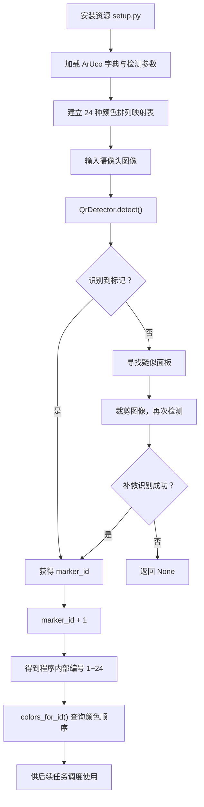
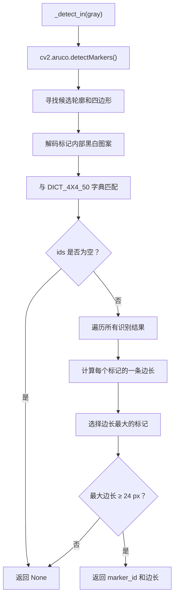
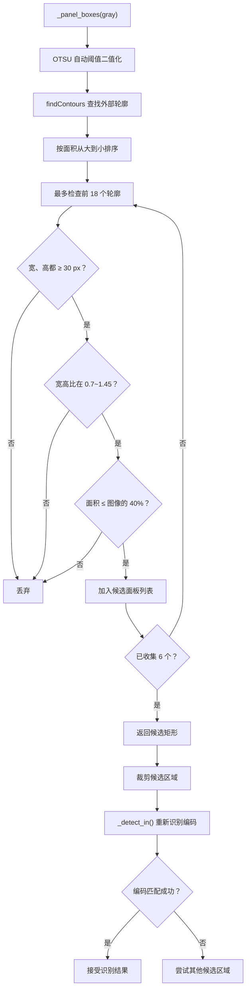
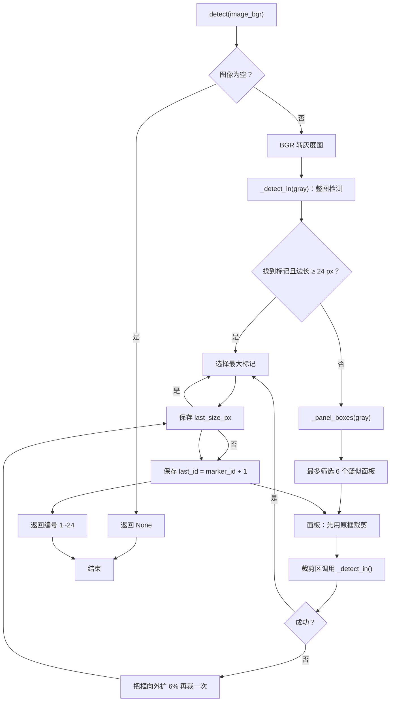
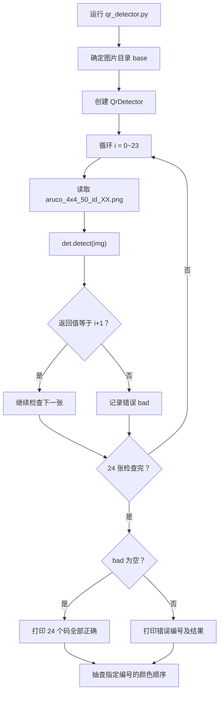

> 本博客只作学习交流，涉及到部分ican比赛的相关内容，如有侵权，立刻删除

## 引言：

假如现在有一个需求：用比赛官方提供的 24 张二维码，读出对应的任务投放顺序——比如顺序 ID 1 对应“红、黄、黑、白”。4 种颜色做全排列正好 4! = 24 种，全部靠读码获得。

先澄清一个容易含糊的地方：官方手册管它叫"二维码"，但它不是 QR 码。 QR 码里编码的是任意文本，要靠纠错算法把内容"解"出来；而窗户上这张是 ArUco 基准标记（fiducial marker），图案来自一个预先定义好的字典——代码里的 DICT_4X4_50 一共只有 50 个固定图案。识别结果不是"内容"，而是图案在字典里的编号 0~49。 这个区别决定了两件事：一是代码里没有"解码字符串"这一步，只有 detectMarkers() 返回的 ids；二是标记本身不携带任何颜色信息，颜色顺序只能查表得到——查的就是官方《判分细则 V1.0》第 7 章的表 8


？ 我要怎么通过这个'二维码'获取到背后的颜色顺序呢 如果你也有这样的疑问，那接下来这个代码就是一个实现方法了

## 正式开始：qr_detector.py 讲解

整个程序是怎么工作的：

### 先看开头 全排列生成与转化

关键防线:sorted 全排列只是"恰好与官方一致"的推导 这里已经做了证明，如果不一致的话需要另外设置一个对照表

```py
#!/usr/bin/env python3

from __future__ import annotations       #导入未来特性让 Python 延迟处理类型说明 它让 Python 延迟处理类型注解，避免大型工程中因为类型未定义、导入顺序、循环引用导致的问题, 而 Optional 才是处理一个返回值可能有多种情况的工具。
import itertools #生成排列 24种二维码的排列
from typing import Dict, List, Optional, Tuple #字典 列表 处理多返回值 元组

import cv2   #Opencv图像识别库
import numpy as np #科学计算库 处理图像数据

COLOR_TO_NUM: Dict[str, int] = {"red": 1, "yellow": 2, "black": 3, "white": 4} #给颜色设置编号 方便之后全排列
NUM_TO_COLOR: Dict[int, str] = {v: k for k, v in COLOR_TO_NUM.items()}  #字典推导式 翻转字典键值对

_PERMS: List[Tuple[int, ...]] = sorted(itertools.permutations([1, 2, 3, 4])) #生成全排列
ID_TO_NUMS: Dict[int, Tuple[int, ...]] = {i + 1: p for i, p in enumerate(_PERMS)} #建立顺序 ID 与数字序列的映射
ID_TO_COLORS: Dict[int, Tuple[str, ...]] = {
    k: tuple(NUM_TO_COLOR[n] for n in v) for k, v in ID_TO_NUMS.items()
} #把数字序列转换成颜色序列
NUMS_TO_ID: Dict[Tuple[int, ...], int] = {v: k for k, v in ID_TO_NUMS.items()} #这样就能根据数字排列反查 ID。例如 (1, 2, 3, 4) 对应 ID 1。


def colors_for_id(order_id: int) -> Tuple[str, ...]:
    return ID_TO_COLORS.get(order_id, ())         #根据顺序ID 获取 颜色顺序


def id_for_colors(colors) -> Optional[int]:    #根据颜色序列查询 ID 
    try:
        nums = tuple(COLOR_TO_NUM[c] for c in colors)
    except (KeyError, TypeError):
        return None
    return NUMS_TO_ID.get(nums)

```
这部分相当于提前制作了一本编号查询字典，而不是每次识别图片时重新计算排列。
举个例子，下面只是映射机制的示例：

| 编号 | 数字排列 | 颜色排列 |
|---|---|---|
| 1 | (1, 2, 3, 4) | red、yellow、black、white |
| 2 | (1, 2, 4, 3) | red、yellow、white、black |
| 3 | (1, 3, 2, 4) | red、black、yellow、white |

这几部分代码分别干什么


简单说就是给颜色顺序全排列

### 图像识别类 初始化 (告诉Opencv图片怎么识别)

```py
class QrDetector:
    MIN_MARKER_PX = 24 #识别的ArUco的边长起码24像素  二维码过远就开始识别影响结果

    def __init__(self, dict_id: int = cv2.aruco.DICT_4X4_50) -> None: #根据 ArUco标记集合获取ID匹配图片 这里比赛官方按DICT_4x4_50 里面已经有按前24(0~23)个的项的编码黑白图生成好并按顺序排好的图片了，只需要识别出来按黑白图的编码对应就知道ID为多少就知道指定的是那个图了 之后按ID对应颜色序号即可
        self.dictionary = cv2.aruco.Dictionary_get(dict_id) #根据字典标识获取真正用于识别的字典对象
        self.params = cv2.aruco.DetectorParameters_create() #创建一组检测配置参数
        #=========检测前预处理========
        self.params.adaptiveThreshWinSizeMin = 5  #自适应阈值 窗口大小从5到45之间选择最适合的那个大小图像处理  
        self.params.adaptiveThreshWinSizeMax = 45
        self.params.adaptiveThreshWinSizeStep = 6 #递进的尝试6次(5-11-17-23-...41)

        self.params.minMarkerPerimeterRate = 0.02      #筛选合适的二维码 最小周长不能太小
        self.params.maxMarkerPerimeterRate = 4.0        # 最大周长 就是不能超过摄像头的范围 所以是四 例如摄像头为800*800的 4是保证周长为800*4的图片能在候选轮廓里，但是实际的最优应该通过测试寻找最优的参数
        self.params.polygonalApproxAccuracyRate = 0.05    #判断摄像头识别出来的边缘是否可以用一个四边形来近似(实际在仿真中摄像头拍到的轮廓不一定就是规整的正方形) 这里允许角度误差为假设某个轮廓周长是 400 px： 400 * 0.05 = 20 px 可以把 20 px 理解为近似过程使用的误差尺度，而不是“允许二维码有 5% 的面积错误”，也不是“只要四个角偏差小于 20 px 就一定通过”。参数较小： 近似更严格，复杂边缘可能难以简化。参数较大： 近似更宽松，复杂轮廓可能更容易被简化，但也可能让不合适的形状进入候选阶段。
        self.params.cornerRefinementMethod = cv2.aruco.CORNER_REFINE_SUBPIX   #精确识别到的图像的四个角 (端点) 角度优化 就是近似到精准的小数角点优化可以提高：ID识别稳定性，远距离检测成功率，边缘模糊情况下的可靠性
        self.last_id: Optional[int] = None    # 记录最近检测成功状态与结果防止下次未检验到时目标与信息丢失
        self.last_size_px: float = 0.0
```
对于DICT_4x4_50为什么可以匹配，我们拿个流程图理解一下


如果还是不太明白的话我们接着往下看

### 图像识别类方法 _detect_in() (如何从图像中找到标记)
函数逻辑



```py
def _detect_in(self, gray: np.ndarray):  #定义一个类内部函数 在给定灰度图上找码 (从输入的灰度图上找到对应的码从而在DICT_4x4_50里找到匹配的码)
        """
        输入：gray ： 摄像头看到的图片
            self.dictionary: 告诉 OpenCV：用哪一本密码本。 也就是 DICT_4x4_50
            self.params: 告诉它怎么找
        ---        
        输出：
            corners: 四个角的坐标
            ids: 使用密码本匹配到的ID
            ——：被拒绝的候选点。(第三个不要)
        """
        corners, ids, _ = cv2.aruco.detectMarkers( 
            gray, self.dictionary, parameters=self.params) #调用 OpenCV ArUco算法进行识别。 输入灰度图 gray->寻找候选轮廓和四边形->提取标记内部的黑白编码->与 self.dictionary 中的编码进行匹配->返回 corners、ids、rejected
        if ids is None or len(ids) == 0: #判断有没有返回ids
            return None    
        #=====选择最大边长的二维码识别结果=====  
        best_id, best_size = None, 0.0
        for pts, mid in zip(corners, ids.flatten()):
            side = float(np.linalg.norm(pts[0][0] - pts[0][1]))
            if side > best_size:
                best_size, best_id = side, int(mid)
        if best_id is None or best_size < self.MIN_MARKER_PX:
            return None
        return best_id, best_size

```

到这步还有一个问题


窗框本身也是矩形，会不会被当成二维码面板？ 答案是：会有可能

### 图像识别类方法 _panel_boxes() (使用了形状筛选和二次识别来降低误判)

具体实现思路


```py
#找“可能贴二维码的白色面板”
    @staticmethod  #不依赖于类，属于工具函数
    def _panel_boxes(gray: np.ndarray, max_n: int = 6): #输入灰度图 ，最大候选区为6
        try:
            _, bw = cv2.threshold(gray, 0, 255,
                                  cv2.THRESH_BINARY + cv2.THRESH_OTSU) #二值化: 将原图变成 000111这种图 使用OTSU自动寻找阈值最佳的黑白分界 例如120 小于120 记录0 为黑色 大于120 记录255 为白色 
        except Exception:
            return []   
        cnts, _ = cv2.findContours(bw, cv2.RETR_EXTERNAL,          
                                   cv2.CHAIN_APPROX_SIMPLE)     #寻找边界 ,RETR_EXTERNAL意思：只找最外层轮廓 CHAIN_APPROX_SIMPLE 轮廓压缩。
        H, W = gray.shape[:2]  #获取图片大小
        boxes = [] 
        for c in sorted(cnts, key=cv2.contourArea, reverse=True)[:max_n * 3]: #计算面积并降序 前18个最大轮廓
            x, y, w, h = cv2.boundingRect(c)
            if w < 30 or h < 30:     #过滤太小
                continue
            if not (0.7 < w / h < 1.45):     #判断正方形  
                continue
            if w * h > 0.4 * W * H:             #过滤太大
                continue
            boxes.append((x, y, w, h))
            if len(boxes) >= max_n:
                break
        return boxes  #返回最可能是二维码的位置 初次筛选 可能有误判区域

```

_panel_boxes() 只负责找出外观上像面板的候选矩形，它并没有识别出二维码。

_detect_in() 才负责调用 ArUco 检测算法，判断候选区域里是否真的存在能匹配字典的标记。

比如窗框满足正方形比例、尺寸也合适，它就可能进入候选列表。但如果里面没有能够匹配 DICT_4X4_50 的有效标记，通常就不会被当成有效结果。

不过，如果窗框内部恰好包含可被算法误解为有效标记的图案，仍有误识别可能。因此，几何筛选是缩小搜索范围，编码匹配才是进一步验证。

### 图像识别类核心函数 detect() (调用和进一步几何筛选)




```py
def detect(self, image_bgr: Optional[np.ndarray],
               debug: bool = False) -> Optional[int]:  
        
        if image_bgr is None or image_bgr.size == 0: #防止没有图像
            return None

        gray = cv2.cvtColor(image_bgr, cv2.COLOR_BGR2GRAY)  #BRG转灰度

        found = self._detect_in(gray) #检测如果成功就直接返回
        how = "整幅画面"
        if found is None:  #可能被误判干扰
            for i, (x, y, w, h) in enumerate(self._panel_boxes(gray)): #调用 _panel_boxes(gray) 寻找白色面板
                for pad in (0, -int(0.06 * w)): #先按面板原框试；失败后把框向外扩 6% 再试(pad 取负→左边界左移、右边界右移)
                    x0, y0 = max(0, x + pad), max(0, y + pad)
                    x1, y1 = min(gray.shape[1], x + w - pad), \
                             min(gray.shape[0], y + h - pad)
                    if x1 - x0 < 30 or y1 - y0 < 30:
                        continue
                    found = self._detect_in(gray[y0:y1, x0:x1]) #裁剪面板
                    if found:
                        how = f"面板{i}裁剪({x1 - x0}px)"
                        break
                if found:
                    break

        if found is None:
            return None
        #如果真找到了 保存ID与大小
        marker_id, side = found
        self.last_size_px = side
        self.last_id = marker_id + 1          
        if debug:
            print(f"    识别途径={how} marker_id={marker_id} 边长={side:.0f}px")
        return self.last_id
```

detect() 采用的是一种常见的先直接检测、失败后再补救的策略。
- 第一次：直接扫描整张图，减少不必要的处理。
- 第二次：如果整图没有找到符合条件的标记，就尝试寻找疑似面板。
- 第三次：裁剪候选面板再识别。每个面板**先按原框裁**，失败后把框**向外扩 6%** 再试一次。
- 最后：成功则返回编号，失败则返回 None。

### 检验检测效果

辅助类方法

```py
#调试显示，把识别结果画出来 画框和显示ID信息
    def annotate(self, image_bgr: np.ndarray) -> np.ndarray:
        out = image_bgr.copy()
        gray = cv2.cvtColor(image_bgr, cv2.COLOR_BGR2GRAY)
        corners, ids, _ = cv2.aruco.detectMarkers(
            gray, self.dictionary, parameters=self.params)
        if ids is not None:
            cv2.aruco.drawDetectedMarkers(out, corners, ids)
            for pts, mid in zip(corners, ids.flatten()):
                x, y = int(pts[0][0][0]), int(pts[0][0][1])
                cv2.putText(out, f"ID={int(mid) + 1}", (x, max(y - 10, 20)),
                            cv2.FONT_HERSHEY_SIMPLEX, 0.9, (0, 255, 0), 2)     
        return out

```

具体流程



```py

if __name__ == "__main__":
    # 自测：把 24 张码全跑一遍
    import os
    import sys

    base = sys.argv[1] if len(sys.argv) > 1 else "."
    det = QrDetector()
    bad = []
    for i in range(24):
        p = os.path.join(base, f"aruco_4x4_50_id_{i:02d}.png")
        img = cv2.imread(p)
        got = det.detect(img)
        if got != i + 1:
            bad.append((i, got))
    if bad:
        print("【ERROR】 有错:", bad)
    else:
        print("【SUCCESS】24 个码全部识别正确（顺序 ID 1~24）")
    print("\n表 8 抽查：")
    for n in (1, 6, 14, 21, 24):
        print(f"   ID {n:2d} → {'、'.join(colors_for_id(n))}")
```

#### 实测：这张成绩单覆盖不到什么

打开 `debug=True` 跑完 24 张，统计每一张实际走的是哪条路径：

```text
路径统计: {'整幅画面': 24}
面板裁剪分支被触发次数: 0
```

也就是说 `_panel_boxes()` 和那段 `pad` 边距逻辑，**一次都没有被执行过**。原因很直接：这 24 张原图本身就是整幅画面的标记，第一次整图检测就成功了，永远走不到面板兜底那条路。

由此这张成绩单的边界也就清楚了：

- 24/24 全绿，只证明“**整图 → 字典匹配 → `+1` 编号**”这条链子接对了；
- 倾斜、模糊、缩放、遮挡，以及**面板裁剪这条兜底路径**，都不在覆盖范围内。

#### 那 `pad` 该往哪个方向偏？

为了弄清这件事，我搭了一个等价场景：白面板 + 与面板同亮的窗框横梁紧贴面板顶边（500×500，标记取官方 `id_20`、160px），把边距从 −40 扫到 +36：

| `pad` | 裁剪尺寸 | 检测结果 | 方向 |
|---:|---|---|---|
| −40 | 340×364 | `id=20` ✅ | 外扩 |
| −24 | 308×332 | `id=20` ✅ | 外扩 |
| −14 | 288×312 | `id=20` ✅ | 外扩（＝代码的第二次迭代）|
| ±0 | 260×284 | `id=20` ✅ | 原框 |
| +12 | 236×260 | `id=20` ✅ | 内缩 |
| +36 | 188×212 | `id=20` ✅ | 内缩 |

结论是**两个方向都能识别** 所以正扩与外扩的区别暂时无法判断

```python
# 判据：在能触发面板分支的帧上比较这三种 pad 序列
for label, pads in (("原样 (0,-k)", (0, -k)),
                    ("只缩 (0,+k)", (0, +k)),
                    ("只原框 (0,)",  (0,))):
    ok = sum(detect_with_pads(gray, pads) is not None for gray in frames)
    print(f"{label}  {ok}/{len(frames)}")
```

## 总结


整个 qr_detector.py 说到底只做了一件事：**把"看图猜颜色顺序"变成"查表找编号"**。

- **全排列预先建表**：24 种颜色顺序在程序启动时就固化成 `ID_TO_COLORS`，运行时不重算，识别到 `marker_id` 只要 `+1` 再查一次字典。
- **ArUco 负责"认出是什么"**：`DICT_4X4_50` 把标记内部的黑白图案解码成一个编号，这是唯一真正下结论的判据。
- **几何筛选负责"先排除不可能"**：`_panel_boxes()` 用尺寸、宽高比、面积占比把上百个轮廓砍到 6 个，它不识别，只负责缩小范围。
- **`detect()` 负责"先易后难"**：整图扫一遍是最省的路径，失败了才裁剪面板重试，用一点冗余换更高的召回率。

写完之后最想强调的还是这一句：

> **形状筛选负责缩小范围，编码匹配才负责下结论。**

窗框没被当成二维码，不是因为它长得不像，而是因为**它里面没有能匹配字典的图案**。反过来，只要几何条件刚好满足、编码又恰好撞上，误判依旧可能发生——所以这类程序的目标从来不是"消灭误判"，而是**把误判一层层收敛到可以接受的范围**。

---

*说明：本文代码运行在仿真环境下，参数是针对当时的分辨率与光照调出来的。换相机、换场地之后，`MIN_MARKER_PX`、`adaptiveThreshWinSizeMin/Max/Step` 这些值建议重新标定——参数表是量出来的，不是抄出来的。*

