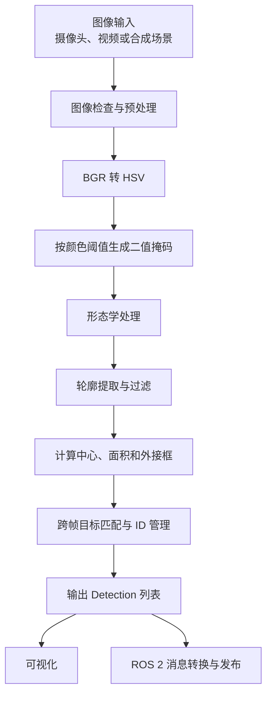
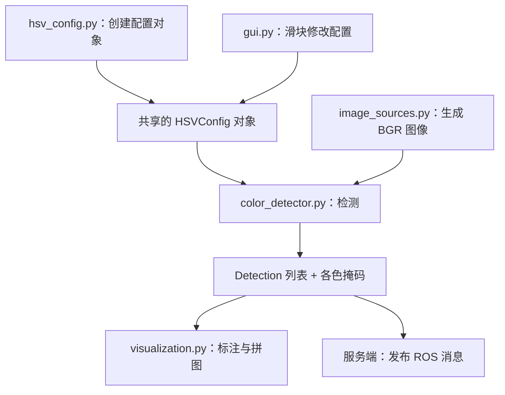

## 引言： 

本博客主要是介绍开源项目[机器视觉颜色分拣系统](https://github.com/VoVL773/Machine_vision_color_sorting_system)的设计思路，实现，与踩坑记录

<div style="background:#e8f4fd; color:#222; padding:16px;border-left:4px solid #5080ccff; border-radius:8px;">
  <strong>这个项目要解决什么问题？最终输入和输出分别是什么？</strong>
  <p>—————————————————————————</p>
  <p>本项目旨在利用 OpenCV 对图像中的指定颜色目标进行检测，并在连续图像帧中维持目标的身份标识，为后续的机器人视觉应用提供目标信息。</p>
  <p>系统主要完成以下任务：</p>
  <ol>
    <li>获取图像，可以来自摄像头、视频文件或合成测试场景。</li>
    <li>将图像转换到 HSV 颜色空间，根据配置的颜色范围提取目标。</li>
    <li>对二值掩码进行形态学处理，减少噪声并改善目标区域。</li>
    <li>提取轮廓，通过面积、尺寸和形状等条件过滤无效区域。</li>
    <li>计算目标的中心坐标、面积和外接矩形。</li>
    <li>根据相邻帧目标的位置匹配结果，为目标分配和维护 ID。</li>
    <li>将结果绘制在图像上，并为后续 ROS 2 通信提供数据基础。</li>
  </ol>
</div>


<details>
  <summary style="font-size:1.2rem; font-weight:700; color:#1E3A5F; cursor:pointer; padding:6px 0;">问题清单(1)</summary>
  <div style="margin:24px 0;">
    <div style="background:#EFF6FF; color:#1E3A5F; border-left:4px solid #3B82F6; padding:16px 20px; border-radius:8px; margin-bottom:12px;">
      <strong>1.为什么先实现独立的 Python 检测程序，再集成到 ROS 2</strong>
    </div>

  <div style="background:#F0FDFA; color:#134E4A; border-left:4px solid #14B8A6; padding:16px 20px; border-radius:8px;">
    <strong>答：</strong>
    <p style="margin:8px 0 0; line-height:1.8;">
      因为视觉算法和 ROS 2 通信属于不同的问题领域,如果算法还没有验证，就直接集成 ROS 2，那么检测失败时 需要排查的问题非常多。<br>
      先用普通 Python 程序验证检测流程，可以把问题范围缩小到图像处理本身。确认检测器能够正确输出结果后，再接入 ROS 2，排查会更容易。
    </p>
  </div>
</div>

<div style="margin:24px 0;">
    <div style="background:#EFF6FF; color:#1E3A5F; border-left:4px solid #3B82F6; padding:16px 20px; border-radius:8px; margin-bottom:12px;">
      <strong>2.一张图像如何经过整个系统？</strong>
    </div>

  <div markdown="1" style="background:#F0FDFA; color:#e4eff3ff; border-left:4px solid #a3d3e5ff; padding:16px 20px; border-radius:8px;">

  </div>
</div>
</details>

## Opencv部分:
<div style="background:#EFF6FF; color:#1E3A5F; border-left:4px solid #3B82F6; padding:16px 20px; border-radius:8px; margin-bottom:12px;">
      <strong>各个模块是怎么协作的</strong>
    </div>


### HSVConfig 颜色阈值配置信息

<details>
  <summary style="font-size:1.2rem; font-weight:700; color:#1E3A5F; cursor:pointer; padding:6px 0;">hsv_cpnfig.py完整代码</summary>
<div style="margin:24px 0;">
  <div markdown="1">
```python
"""HSV colour threshold configuration and JSON persistence."""

from __future__ import annotations

from dataclasses import dataclass, field
import json
import os
from typing import Any, Dict, List, Sequence, Tuple

COLOR_ORDER = ('red', 'green', 'blue', 'yellow')

# OpenCV HSV ranges: H in [0, 179], S and V in [0, 255].
DEFAULT_COLORS: Dict[str, Dict[str, Any]] = {
    'red': {
        'enabled': True,
        'wrap_hue': True,
        'lower': [0, 120, 70],
        'upper': [10, 255, 255],
    },
    'green': {
        'enabled': True,
        'wrap_hue': False,
        'lower': [40, 80, 50],
        'upper': [85, 255, 255],
    },
    'blue': {
        'enabled': True,
        'wrap_hue': False,
        'lower': [100, 120, 70],
        'upper': [140, 255, 255],
    },
    'yellow': {
        'enabled': True,
        'wrap_hue': False,
        'lower': [15, 80, 80],
        'upper': [38, 255, 255],
    },
}

DEFAULT_FILTER: Dict[str, Any] = {
    'min_area': 300,
    'max_area': 0,
    'min_dimension': 8,
    'min_fill_ratio': 0.20,
}

DEFAULT_MORPHOLOGY: Dict[str, Any] = {
    'kernel': 5,
    'iterations': 1,
    'blur_kernel': 3,
}

DEFAULT_CONFIG_VERSION = 2

# Yellow defaults before config version 2.  A saved configuration that still
# uses these exact values is migrated so that golden/orange-yellow objects are
# detected after upgrading.
LEGACY_YELLOW_LOWER = [20, 100, 100]
LEGACY_YELLOW_UPPER = [35, 255, 255]


def _as_int(value: Any, field_name: str) -> int:
    """Convert a JSON value to int, rejecting booleans and fractions."""
    if isinstance(value, bool) or not isinstance(value, (int, float)):
        raise ValueError(f'{field_name} must be an integer, got {value!r}')
    number = int(value)
    if number != value:
        raise ValueError(f'{field_name} must be an integer, got {value!r}')
    return number


def _as_float(value: Any, field_name: str) -> float:
    """Convert a JSON value to float, rejecting booleans."""
    if isinstance(value, bool) or not isinstance(value, (int, float)):
        raise ValueError(f'{field_name} must be a number, got {value!r}')
    return float(value)


def _as_bool(value: Any, field_name: str) -> bool:
    """Convert a JSON value to bool."""
    if isinstance(value, bool):
        return value
    if isinstance(value, int) and value in (0, 1):
        return bool(value)
    if isinstance(value, str) and value.lower() in ('true', 'false'):
        return value.lower() == 'true'
    raise ValueError(f'{field_name} must be a boolean, got {value!r}')


def _as_triplet(values: Any, limits: Sequence[int], field_name: str) -> Tuple[int, int, int]:
    """Validate a three-element HSV triplet and clamp it to its limits."""
    if not isinstance(values, Sequence) or isinstance(values, (str, bytes)):
        raise ValueError(f'{field_name} must be a list of three integers')
    if len(values) != 3:
        raise ValueError(f'{field_name} must contain exactly three values')
    result = []
    for index, (value, limit) in enumerate(zip(values, limits)):
        number = _as_int(value, f'{field_name}[{index}]')
        if number < 0 or number > limit:
            raise ValueError(f'{field_name}[{index}] must be in [0, {limit}]')
        result.append(number)
    return (result[0], result[1], result[2])


@dataclass
class ColorThreshold:
    """HSV threshold for one colour class."""

    enabled: bool = True
    wrap_hue: bool = False
    lower: Tuple[int, int, int] = (0, 0, 0)
    upper: Tuple[int, int, int] = (179, 255, 255)

    def __post_init__(self) -> None:
        """Validate and normalise the threshold values."""
        self.enabled = _as_bool(self.enabled, 'enabled')
        self.wrap_hue = _as_bool(self.wrap_hue, 'wrap_hue')
        self.lower = _as_triplet(self.lower, (179, 255, 255), 'lower')
        self.upper = _as_triplet(self.upper, (179, 255, 255), 'upper')
        if self.lower[0] > self.upper[0]:
            raise ValueError(
                f'hue lower bound {self.lower[0]} is greater than upper bound {self.upper[0]}')
        for channel, name in enumerate(('saturation', 'value')):
            if self.lower[channel + 1] > self.upper[channel + 1]:
                raise ValueError(
                    f'{name} lower bound {self.lower[channel + 1]} is greater than '
                    f'upper bound {self.upper[channel + 1]}')

    @classmethod
    def from_dict(cls, data: Any, name: str = 'color') -> 'ColorThreshold':
        """Build a threshold from a JSON-like dictionary."""
        if not isinstance(data, dict):
            raise ValueError(f'color {name!r} must be an object')
        threshold = cls(
            enabled=_as_bool(data.get('enabled', True), f'{name}.enabled'),
            wrap_hue=_as_bool(data.get('wrap_hue', False), f'{name}.wrap_hue'),
            lower=_as_triplet(data.get('lower', [0, 0, 0]), (179, 255, 255),
                              f'{name}.lower'),
            upper=_as_triplet(data.get('upper', [179, 255, 255]), (179, 255, 255),
                              f'{name}.upper'),
        )
        return threshold

    def to_dict(self) -> Dict[str, Any]:
        """Return a JSON-serialisable representation."""
        return {
            'enabled': self.enabled,
            'wrap_hue': self.wrap_hue,
            'lower': list(self.lower),
            'upper': list(self.upper),
        }

    def mask_ranges(self) -> List[Tuple[Tuple[int, int, int], Tuple[int, int, int]]]:
        """
        Return the inRange intervals for this colour.

        When ``wrap_hue`` is enabled, a second interval is added around hue 180
        so that red colours on both sides of the OpenCV hue wrap are captured.
        """
        ranges = [(self.lower, self.upper)]
        if self.wrap_hue:
            wrap_low = max(0, 180 - self.upper[0])
            wrap_high = 179
            if wrap_low <= wrap_high:
                ranges.append(
                    ((wrap_low, self.lower[1], self.lower[2]),
                     (wrap_high, self.upper[1], self.upper[2])))
        return ranges


@dataclass
class HSVConfig:
    """Full detector configuration: per-colour thresholds and filters."""

    colors: Dict[str, ColorThreshold] = field(
        default_factory=lambda: {
            name: ColorThreshold.from_dict(data, name)
            for name, data in DEFAULT_COLORS.items()
        })
    min_area: int = 300
    max_area: int = 0
    min_dimension: int = 8
    min_fill_ratio: float = 0.20
    morph_kernel: int = 5
    morph_iterations: int = 1
    blur_kernel: int = 3

    def __post_init__(self) -> None:
        """Validate the configuration after construction."""
        self.validate()

    def validate(self) -> None:
        """Validate all fields and raise ValueError when invalid."""
        if not isinstance(self.colors, dict) or not self.colors:
            raise ValueError('colors must be a non-empty object')
        if not all(isinstance(name, str) and name for name in self.colors):
            raise ValueError('colour names must be non-empty strings')
        for name, threshold in self.colors.items():
            if not isinstance(threshold, ColorThreshold):
                raise ValueError(f'color {name!r} is not a ColorThreshold')
            checked = ColorThreshold(
                enabled=threshold.enabled,
                wrap_hue=threshold.wrap_hue,
                lower=threshold.lower,
                upper=threshold.upper,
            )
            threshold.enabled = checked.enabled
            threshold.wrap_hue = checked.wrap_hue
            threshold.lower = checked.lower
            threshold.upper = checked.upper

        self.min_area = _as_int(self.min_area, 'filter.min_area')
        self.max_area = _as_int(self.max_area, 'filter.max_area')
        self.min_dimension = _as_int(self.min_dimension, 'filter.min_dimension')
        self.min_fill_ratio = _as_float(self.min_fill_ratio, 'filter.min_fill_ratio')
        self.morph_kernel = _as_int(self.morph_kernel, 'morphology.kernel')
        self.morph_iterations = _as_int(self.morph_iterations, 'morphology.iterations')
        self.blur_kernel = _as_int(self.blur_kernel, 'morphology.blur_kernel')

        if self.min_area < 0:
            raise ValueError('filter.min_area must be >= 0')
        if self.max_area < 0:
            raise ValueError('filter.max_area must be >= 0')
        if self.max_area and self.max_area < self.min_area:
            raise ValueError('filter.max_area must be 0 or >= filter.min_area')
        if self.min_dimension < 0:
            raise ValueError('filter.min_dimension must be >= 0')
        if not 0.0 <= self.min_fill_ratio <= 1.0:
            raise ValueError('filter.min_fill_ratio must be in [0.0, 1.0]')
        if not 0 <= self.morph_kernel <= 31:
            raise ValueError('morphology.kernel must be in [0, 31]')
        if self.morph_iterations < 0:
            raise ValueError('morphology.iterations must be >= 0')
        if not 0 <= self.blur_kernel <= 31:
            raise ValueError('morphology.blur_kernel must be in [0, 31]')

    @classmethod
    def default(cls) -> 'HSVConfig':
        """Return the built-in default configuration."""
        return cls()

    @classmethod
    def from_dict(cls, data: Any) -> 'HSVConfig':
        """Build a configuration from a JSON-like dictionary."""
        if not isinstance(data, dict):
            raise ValueError('configuration root must be an object')

        colors_data = data.get('colors', {})
        if not isinstance(colors_data, dict):
            raise ValueError('colors must be an object')

        version = _as_int(data.get('version', 1), 'version')
        if version < DEFAULT_CONFIG_VERSION:
            legacy_yellow = colors_data.get('yellow')
            if (isinstance(legacy_yellow, dict)
                    and legacy_yellow.get('lower') == LEGACY_YELLOW_LOWER
                    and legacy_yellow.get('upper') == LEGACY_YELLOW_UPPER):
                colors_data = dict(colors_data)
                migrated = {
                    key: value for key, value in legacy_yellow.items()
                    if key not in ('lower', 'upper')}
                colors_data['yellow'] = {
                    **DEFAULT_COLORS['yellow'], **migrated}

        colors: Dict[str, ColorThreshold] = {}
        for name in COLOR_ORDER:
            raw = colors_data.get(name, DEFAULT_COLORS[name])
            if isinstance(raw, dict):
                raw = {**DEFAULT_COLORS[name], **raw}
            colors[name] = ColorThreshold.from_dict(raw, name)
        for name, raw in colors_data.items():
            if name not in colors:
                colors[name] = ColorThreshold.from_dict(raw, name)

        filter_data = data.get('filter', {})
        morphology_data = data.get('morphology', {})
        if not isinstance(filter_data, dict):
            raise ValueError('filter must be an object')
        if not isinstance(morphology_data, dict):
            raise ValueError('morphology must be an object')

        config = cls(
            colors=colors,
            min_area=filter_data.get('min_area', DEFAULT_FILTER['min_area']),
            max_area=filter_data.get('max_area', DEFAULT_FILTER['max_area']),
            min_dimension=filter_data.get(
                'min_dimension', DEFAULT_FILTER['min_dimension']),
            min_fill_ratio=filter_data.get(
                'min_fill_ratio', DEFAULT_FILTER['min_fill_ratio']),
            morph_kernel=morphology_data.get(
                'kernel', DEFAULT_MORPHOLOGY['kernel']),
            morph_iterations=morphology_data.get(
                'iterations', DEFAULT_MORPHOLOGY['iterations']),
            blur_kernel=morphology_data.get(
                'blur_kernel', DEFAULT_MORPHOLOGY['blur_kernel']),
        )
        return config

    def to_dict(self) -> Dict[str, Any]:
        """Return a JSON-serialisable representation."""
        return {
            'version': DEFAULT_CONFIG_VERSION,
            'colors': {name: threshold.to_dict()
                       for name, threshold in self.colors.items()},
            'filter': {
                'min_area': self.min_area,
                'max_area': self.max_area,
                'min_dimension': self.min_dimension,
                'min_fill_ratio': self.min_fill_ratio,
            },
            'morphology': {
                'kernel': self.morph_kernel,
                'iterations': self.morph_iterations,
                'blur_kernel': self.blur_kernel,
            },
        }

    @classmethod
    def load(cls, path: str) -> 'HSVConfig':
        """Load and validate a configuration from ``path``."""
        expanded = os.path.expanduser(path)
        with open(expanded, 'r', encoding='utf-8') as stream:
            try:
                data = json.load(stream)
            except json.JSONDecodeError as exc:
                raise ValueError(
                    f'invalid JSON in {expanded}: {exc.msg} at line {exc.lineno}') from exc
        try:
            return cls.from_dict(data)
        except ValueError as exc:
            raise ValueError(f'invalid HSV configuration {expanded}: {exc}') from exc

    def save(self, path: str) -> str:
        """Validate and atomically write the configuration to ``path``."""
        expanded = os.path.abspath(os.path.expanduser(path))
        self.validate()
        parent = os.path.dirname(expanded)
        if parent:
            os.makedirs(parent, exist_ok=True)
        temporary = f'{expanded}.tmp'
        with open(temporary, 'w', encoding='utf-8') as stream:
            json.dump(self.to_dict(), stream, indent=2, ensure_ascii=False)
            stream.write('\n')
        os.replace(temporary, expanded)
        return expanded

```
  </div>
</div>
</details>

代码很长但要解释起来并不难把颜色阈值、面积过滤、形态学参数组织成一个对象生成所需要的配置信息，保存和读取配置信息 通过配置对象与其他模块结合

[详细教程见仓库](https://github.com/VoVL773/Machine_vision_color_sorting_system/blob/main/md/%E4%BA%8C.%E5%8C%85%E9%AA%A8%E6%9E%B6%E5%88%9B%E5%BB%BA%E4%B8%8E%20HSV%20%E9%85%8D%E7%BD%AE%E5%B1%82.md)

