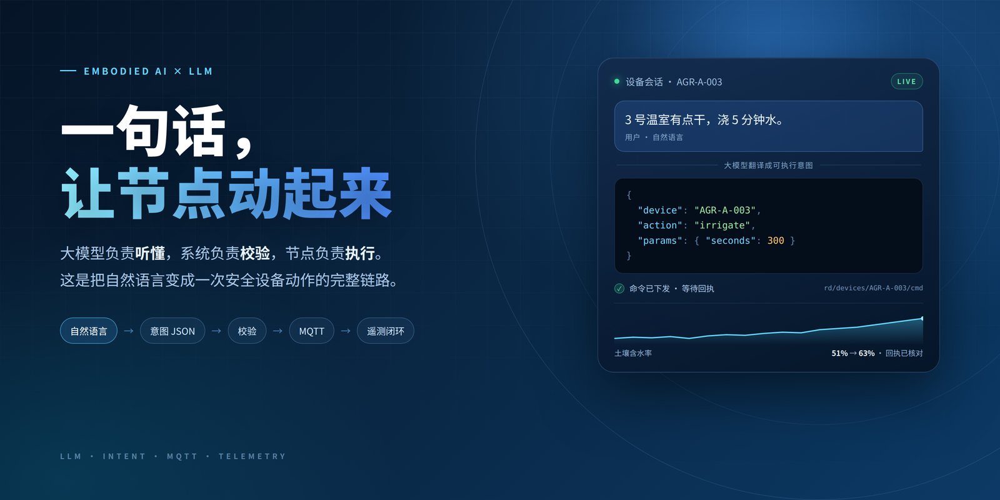
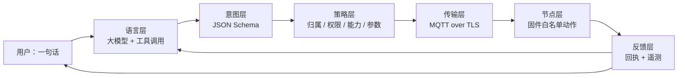
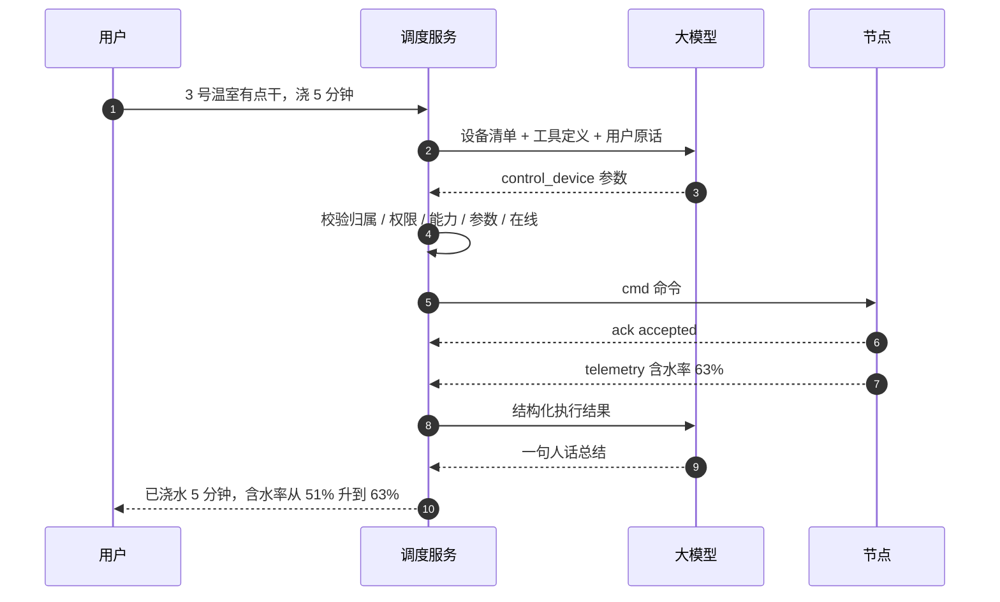

> “3 号温室有点干，浇 5 分钟水，浇完告诉我含水率。”

先别急着讨论模型有多大。这句话要变成一次真实的设备动作，中间至少隔着五道关：**指的是哪台设备、对应什么动作、参数是多少、这个账号准不准、做完怎么确认。**

很多“大模型控制硬件”的演示停在第一关：模型输出一段 JSON，串口灯闪一下，视频就结束了。真实系统难在后面四关。

这篇文章讲的就是后面四关。结论先放这儿：

> **大模型只做翻译，系统做决定，设备做执行。** 模型的上限决定它能听懂多少，系统的边界决定它敢做多少。

下面的代码是可以直接改造的骨架，省略了完整的鉴权中间件、日志和重试细节，重点是把分工摆清楚。



## 0. 先把“具身智能节点”落到地上

“具身智能”这个词容易让人想到人形机器人。但严格说，它强调的是**智能来自身体与环境的交互**：有感知、有动作、有反馈，智能才有意义。工程上，我们面对的往往不是人形机器人，而是一个个很小的节点：

- 一块 ESP8266 或 ESP32，接着温湿度传感器和一个继电器；
- 继电器控制水泵、风机或卷帘门；
- 通过 Wi-Fi 连上 MQTT Broker，定时上报读数。

这类节点“智能”的下限很低：它只会采集、执行和回执。真正“听懂人话”的部分不在板子上，而在云端。**这不是缺陷，反而是安全设计**：把理解放在云上，把确定性留在本地。

一个节点在系统里必须能回答四个问题，缺一个都没法安全地“被控制”：

| 要素 | 回答的问题 | 缺失的后果 |
| --- | --- | --- |
| 身份 | 它是谁，凭什么连进来 | 身份混用、越权、串数据 |
| 能力 | 它支持哪些动作 | 下发不支持的动作，轻则无响应，重则误动作 |
| 状态 | 它现在在线吗，读数是多少 | 给离线设备发命令，命令石沉大海 |
| 动作 | 每个动作接受什么参数 | 参数越界，水泵空转或者直接溢水 |

打个比方：节点像**一个有手有脚、但只会听工单干活的工人**。大模型不是这个工人，它更像**调度中心的翻译官**：把老板嘴里的话写成一张结构清晰的工单。翻译官要是直接冲进车间拧阀门，迟早出事。

## 1. 为什么不能让大模型直接操作设备

最直觉的做法是给模型一个 MQTT 客户端，让它自己拼 Topic、发消息。这个方案在演示里很酷，在生产里很危险：

- **它不知道“有没有这台设备”。** 模型可能编出一个看起来特别合理的 `GREENHOUSE-03`，然后一本正经地发出去。
- **它不知道“现在能不能做”。** 设备离线、传感器故障、水泵正在检修，这些状态都不在语言里。
- **它不应该持有凭证。** 把设备密钥交给一个会“合理想象”的组件，等于把钥匙交给一个会梦游的人。
- **它无法保证只执行一次。** 网络重试、用户重复提问、工具调用重放，都可能让“浇 5 分钟”变成“浇 15 分钟”。
- **它分不清“指令”和“数据”。** 设备名称、传感器读数、用户上传的文本里，都可能藏着提示注入。

所以更稳的分工是：

| 做法 | 谁做决定 | 风险 | 适合场景 |
| --- | --- | --- | --- |
| 模型直接下发 | 模型 | 幻觉、越权、重复执行都没法在模型层兜住 | 演示、沙箱 |
| 模型产出意图，系统执行 | 系统 | 模型只影响“想做什么”，不影响“能不能做” | 真实设备 |

一句话：**让模型填表，不要让模型执行。**

“工具调用”这个名字有点误导。模型并没有真的调用你的函数，它只是生成了一段符合 schema 的参数。真正执行的是你的代码。想明白这一点，后面的设计就顺了。

## 2. 整条链路长什么样

把上面这些角色摆在一起，一条完整的控制链路是这样的：



四个阶段，各管一段：

| 阶段 | 输入 | 输出 | 失败时怎么办 |
| --- | --- | --- | --- |
| 理解 | 自然语言 + 设备清单 | 结构化意图 | 追问，或者明确拒绝 |
| 校验 | 结构化意图 | 可执行命令 | 抛错，绝不下发 |
| 执行 | 可执行命令 | 设备动作 + 回执 | 超时、重试或人工介入 |
| 反馈 | 回执 + 遥测 | 可核对的结果 | 报告异常，而不是假装成功 |

下面逐个说。

## 3. 第一步：把自然语言翻译成意图

### 3.1 schema 就是合同

让模型“输出 JSON”是不够的，得给它一份有约束的合同。下面这份 function 定义里，动作是枚举，参数有上下限，设备编号要求来自清单：

```json
{
  "type": "function",
  "function": {
    "name": "control_device",
    "description": "向一台已登记的节点下发动作。动作与参数都有硬性范围，越界会被平台拒绝。",
    "parameters": {
      "type": "object",
      "properties": {
        "device_id": {
          "type": "string",
          "description": "设备清单中的节点编号，不得自行编造"
        },
        "action": {
          "type": "string",
          "enum": ["irrigate", "stop_irrigation", "set_fan", "read_sensors"]
        },
        "params": {
          "type": "object",
          "properties": {
            "seconds": { "type": "integer", "minimum": 1, "maximum": 600 },
            "level": { "type": "integer", "minimum": 0, "maximum": 3 }
          },
          "additionalProperties": false
        },
        "reason": {
          "type": "string",
          "description": "一句话说明判断依据，写入审计日志"
        }
      },
      "required": ["device_id", "action", "params"]
    }
  }
}
```

几个设计细节值得展开：

- `action` 用 `enum`，不要用自由字符串。模型的自由发挥空间越小，后面要兜的底越少。
- `params` 设 `additionalProperties: false`，防止模型往里面塞没定义过的字段，比如自创一个 `duration`。
- 要求模型填 `reason`，不是为了听它解释，而是给审计日志留证据。
- 设备清单放进上下文，并要求“只能从清单里选”。但注意：**schema 和提示词都不是安全边界**，它们只降低出错概率，真正的边界在下一节的校验。

另外要清楚 JSON Schema 的局限：它能表达“`seconds` 是 1 到 600 的整数”，但表达不了“只有 `irrigate` 动作才需要 `seconds`，`stop_irrigation` 不该带参数”。这类跨字段的语义，必须由服务端自己判断。

### 3.2 系统提示词

工具定义管“能填什么”，系统提示词管“什么时候别填”：

```text
你是设备调度助手。你可以调用 control_device 向节点下发动作。

规则：
1. 只能使用“设备清单”里出现的 device_id；清单里没有的，直接说明并请用户确认，不要编造。
2. 动作只能来自枚举；用户要求的功能不在枚举内时，说明当前支持哪些，不要强行套用。
3. 缺少必要参数时先追问，不要自己填一个“合理值”。
4. 不要输出 MQTT 地址、Topic、设备密钥等内部信息。
5. 涉及“全部设备”“一直开着”“关闭告警”等大范围或高风险操作时，先复述影响范围，等用户明确确认后再下发。
```

第 3 条尤其重要。用户说“把温室弄舒服点”，正确反应是问：“您是想通风、降温，还是浇水？”追问比瞎猜便宜得多——猜错的代价可能是一地水。

### 3.3 调用的样子

以支持 function calling 的模型为例，拿到参数之后先别执行，交给校验：

```python
import json
from openai import OpenAI

client = OpenAI(base_url="https://your-gateway/v1", api_key="...")

TOOLS = [TOOL_SCHEMA]   # TOOL_SCHEMA 就是上面那段 JSON

def ask(messages):
    response = client.chat.completions.create(
        model="your-model",
        messages=messages,
        tools=TOOLS,
        tool_choice="auto",
        temperature=0,          # 参数化任务，别让它发挥
    )
    message = response.choices[0].message
    if not message.tool_calls:
        return None, message.content      # 模型选择追问或拒绝

    call = message.tool_calls[0]
    # 有多个工具时，还要按 call.function.name 分发
    return json.loads(call.function.arguments), message.content
```

这里返回的是 `(参数字典, 模型原话)`，不是“已经执行”。参数是字符串解析出来的普通对象，跟用户随手发来的一段 JSON 没有本质区别——这一点决定了下一步怎么做。

## 4. 第二步：校验，把“可能”变成“可以”

模型输出是不可信输入。它和来自公网的 HTTP 请求应该被一视同仁：

```python
from dataclasses import dataclass


@dataclass(frozen=True)
class Node:
    id: str
    company: str
    online: bool
    capabilities: frozenset[str]


class IntentError(ValueError):
    """意图不合法，拒绝执行。"""


ACTION_RULES = {
    "irrigate": {"seconds": (1, 600)},
    "stop_irrigation": {},
    "set_fan": {"level": (0, 3)},
    "read_sensors": {},
}


def validate(intent, user, nodes):
    node = nodes.get(intent.get("device_id"))
    if node is None:
        raise IntentError("设备不存在")
    if node.company != user["company"]:
        raise IntentError("设备不属于当前公司")

    action = intent.get("action")
    rules = ACTION_RULES.get(action)
    if rules is None:
        raise IntentError("未知动作")
    if action not in node.capabilities:
        raise IntentError("设备不支持该动作")

    params = intent.get("params") or {}
    for key, (low, high) in rules.items():
        value = params.get(key)
        if isinstance(value, bool) or not isinstance(value, int):
            raise IntentError(f"参数 {key} 必须是整数")
        if not low <= value <= high:
            raise IntentError(f"参数 {key} 超出范围 {low}-{high}")

    if not node.online:
        raise IntentError("设备离线")

    return node
```

每一行都在挡一种具体的错误：

| 校验项 | 挡的是什么 | 不做的后果 |
| --- | --- | --- |
| 设备存在 | 模型编造的编号 | 命令发往不存在的 Topic |
| 归属公司 | 跨租户越权 | 客户 A 控制客户 B 的设备 |
| 能力匹配 | 动作与设备型号不符 | 给没有水泵的节点发浇水 |
| 参数类型与范围 | 字符串、布尔、超大值 | 固件解析失败或执行越界 |
| 在线状态 | 对离线设备下发 | 命令无人接收，却报告成功 |

`isinstance(value, bool)` 这一句不是洁癖。Python 里 `True` 是 `int` 的子类，不排除的话，模型填的 `true` 会被当成 `1` 通过范围检查。

还有两件事校验管不了，得在更外层处理：**重复**和**确认**。同一个请求重试两次，应该只执行一次；高风险动作（全屋浇水、长时间开泵）应该要求人工二次确认。前者靠幂等键，后者靠产品流程，都不该指望模型自己记住。

## 5. 第三步：下发，一条命令长什么样

### 5.1 Topic 与载荷

上行和下行分开，权限才做得干净：

| 方向 | Topic | 谁发布 | 谁订阅 |
| --- | --- | --- | --- |
| 上行 | `rd/devices/<device_id>/telemetry` | 设备 | 平台 |
| 下行 | `rd/devices/<device_id>/cmd` | 平台 | 设备 |

命令载荷建议带上这几个字段：

| 字段 | 作用 |
| --- | --- |
| `request_id` | 幂等键，设备用它去重，服务端用它关联回执 |
| `action` | 动作名，必须是白名单 |
| `params` | 动作参数 |
| `issued_at` | 签发时间 |
| `ttl` | 有效期，过期命令不应再执行 |

### 5.2 发布

```python
import json
import time
import uuid


def dispatch(client, device_id, action, params, ttl=10):
    request_id = uuid.uuid4().hex
    payload = {
        "request_id": request_id,
        "action": action,
        "params": params,
        "issued_at": int(time.time()),
        "ttl": ttl,
    }
    client.publish(
        f"rd/devices/{device_id}/cmd",
        json.dumps(payload),
        qos=1,
        retain=False,
    )
    return request_id
```

三个容易忽略的点：

- **`retain=False`。** 保留消息会让下一次上线的设备收到一条历史命令。想象一下，一台刚修好的水泵收到三天前的“开始浇水”。
- **QoS 1 只保证“至少一次”，不保证“只一次”。** 所以 `request_id` 必须有，设备必须去重。
- **TTL 要有。** 网络恢复后积压的命令，不该在半小时后突然生效。

### 5.3 节点侧

固件里没有自然语言，只有动作名和参数：

```cpp
void onCommand(char *topic, byte *payload, unsigned int length) {
  JsonDocument doc;                       // ArduinoJson 7；6.x 用 StaticJsonDocument<256>
  if (deserializeJson(doc, payload, length)) return;

  const char *id = doc["request_id"];
  const char *action = doc["action"];
  if (!id || !action) return;
  // issued_at / ttl 由平台在入队前检查；固件完成 NTP 对时后，也可以在这里再复查一次
  if (alreadySeen(id)) return;            // QoS 1 可能重复投递

  if (strcmp(action, "irrigate") == 0) {
    int seconds = doc["params"]["seconds"] | 0;
    if (seconds < 1 || seconds > 600) {
      ack(id, "rejected");
      return;
    }
    startPump(seconds);
    ack(id, "accepted");
  } else {
    ack(id, "unsupported");
  }
}
```

**这是故意的**：板子不负责理解，只负责执行和拒绝。它不认识“有点干”，只认识 `irrigate` 和 `300`。参数范围在固件里再挡一次，是因为服务端的校验和固件的版本可能不同步——两边都挡，成本很低，收益很高。

顺带一提，水泵这类执行器还应该有本地联锁：比如最长连续运行时间、水位过低自动停。这类保护不能依赖云端，断网时它得自己管用。

## 6. 第四步：反馈，动作到底有没有生效

命令发出去不等于事情做完。水泵可能没接好，继电器可能坏了，阀门可能本来就是关的。

一个务实的做法是：下发之后不急着报告成功，而是等一个可观测的效果。

```python
import time


def wait_effect(latest, predicate, timeout=30, interval=2):
    deadline = time.monotonic() + timeout
    while time.monotonic() < deadline:
        reading = latest()
        if reading is not None and predicate(reading):
            return reading
        time.sleep(interval)
    raise TimeoutError("等待设备生效超时")
```

示例里用阻塞的 `sleep` 是为了好读；真实服务里通常换成事件驱动或异步等待，避免一个请求占住一个线程。

调用的时候，把“效果”写成可验证的条件：

```python
before = latest("AGR-A-003")["soilMoisture"]
request_id = dispatch(client, "AGR-A-003", "irrigate", {"seconds": 300})
# 节点回执里会带回同一个 request_id，用它把“这条命令”和“这次效果”对上
reading = wait_effect(
    lambda: latest("AGR-A-003"),
    lambda r: r["soilMoisture"] > before + 3,
    timeout=300,
)
```

整条链路串起来，时序是这样的：



注意最后一步的顺序：**先有事实，再有措辞**。不要让模型在事实之前先编一个结论——“应该没问题吧”这种话，在设备控制里是最危险的输出。

## 7. 完整走一遍

把上面所有片段拼起来，一次请求大致是这样流动的（时间数字只是示意）：

| 时刻 | 发生了什么 | 数据 |
| --- | --- | --- |
| T+0 | 用户说 | “3 号温室有点干，浇 5 分钟水” |
| T+1s | 调度器读取设备快照 | AGR-A-003 在线，支持 `irrigate`，含水率 51% |
| T+2s | 模型返回意图 | `device_id=AGR-A-003, action=irrigate, seconds=300` |
| T+2.3s | 服务端校验通过 | 归属、权限、能力、参数、在线，五项全过 |
| T+2.4s | 下发命令 | `request_id=7f3c...`，TTL 10 秒 |
| T+3s | 节点回执 | `accepted` |
| T+3s 到 T+5min | 水泵工作，设备持续上报 | 含水率开始上升 |
| T+5min | 效果核对 | 51% → 63%，超过阈值 |
| T+5min | 模型组织语言 | “已浇水 5 分钟，含水率从 51% 升到 63%” |

这里最容易被忽略的是 T+2.3s 和 T+5min：一个在“执行之前”把关，一个在“执行之后”核对。很多系统两头都省略，只保留中间那一下“发送成功”，于是“成功”变成了一句没有证据的话。

## 8. 安全清单

把上面的经验压成一张表，上线前逐项过一遍：

| 风险 | 具体表现 | 对策 |
| --- | --- | --- |
| 模型幻觉 | 编造设备编号、动作名、参数 | schema 枚举 + 服务端查库 + 固件白名单 |
| 越权 | 客户操作了别家公司的设备 | 服务端按账号归属判定，不靠前端隐藏 |
| 参数越界 | 浇水 10 小时、风扇档位 99 | schema 范围 + 服务端复验 + 固件硬限制 |
| 重复执行 | 重试、重放导致动作叠加 | `request_id` 幂等 + 设备去重 + TTL |
| 历史命令复活 | 新上线设备收到旧的 retained 消息 | 命令不保留，`retain=False` |
| 提示注入 | 设备名或读数里藏着“忽略以上规则” | 外部文本只当数据，永远不拼进系统指令 |
| 误操作 | “全部设备”“一直开着” | 高风险动作二次确认 + 审计日志 |
| 断网 | 命令丢失或回执缺失 | 超时机制 + 明确报告未知状态 |

还有一条不那么技术、但很关键：**把常见说法收集成回归用例**。比如“有点干”“湿度低了”“帮我浇一下”，每次改提示词或换模型，跑一遍，看意图是否仍然正确。模型升级带来的回归，往往比代码 bug 更隐蔽。

## 9. 什么时候不该用大模型

大模型不是万能胶。下面这些场景，规则和硬件比它可靠：

- **安全联锁。** 水位过低停泵、超温断电、急停按钮，必须本地闭环，不能等云端推理。
- **毫秒级控制。** 大模型一次往返动辄几百毫秒到几秒，不适合做实时控制回路。
- **确定性批量规则。** “温度高于 30 度就开风机”这种逻辑，用规则引擎更便宜、更可测。
- **强审计场景。** 每一步都要人工审批的操作，模型只适合做“起草”，不适合做“决定”。

反过来，大模型真正擅长的是**把模糊的表达收敛成明确的参数**：同一件事有一百种说法，用户不想学你的按钮布局，这时候它才有价值。

如果动作种类很多，不要靠堆提示词，做一个**能力注册表**：每个设备型号声明自己支持的动作、参数范围和前置条件，schema 从注册表生成，校验也读同一份注册表。这样新增设备是加数据，不是改提示词。

## 10. 写在最后

回到开头那句话：“3 号温室有点干，浇 5 分钟水。”

它最后能安全地变成一次真实动作，靠的不是模型有多聪明，而是每一层都只做自己该做的事：

- 语言层负责**听懂**，把“有点干”翻译成 `irrigate`；
- 策略层负责**判断**，确认这台设备、这个账号、这组参数都说得通；
- 传输层负责**送达**，用带幂等键和有效期的消息；
- 节点层负责**执行**，只认白名单动作，并如实回执；
- 反馈层负责**核对**，用遥测证明事情真的发生了。

模型的上限，决定它能听懂多少；系统的边界，决定它敢做多少。

> 让模型只做翻译，让系统做决定，让设备做执行。这三件事分开，“智能”才敢真正落地。
