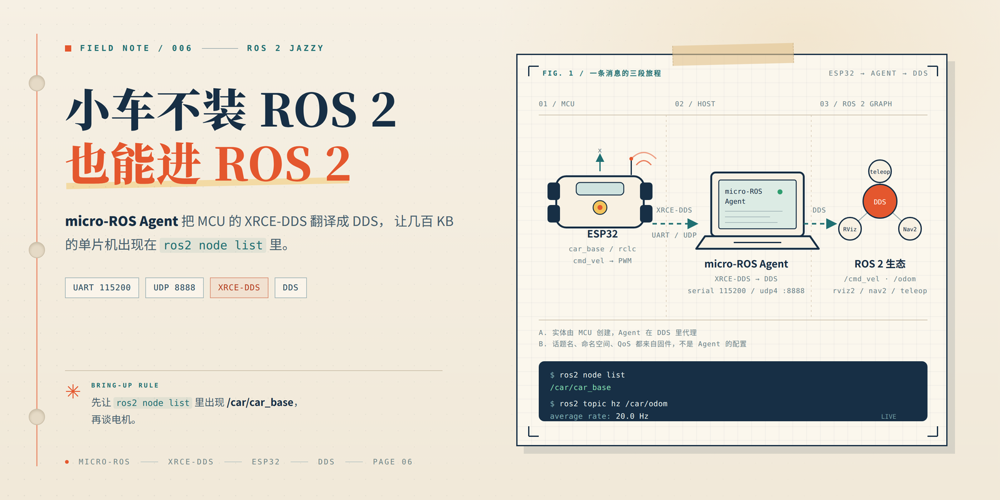
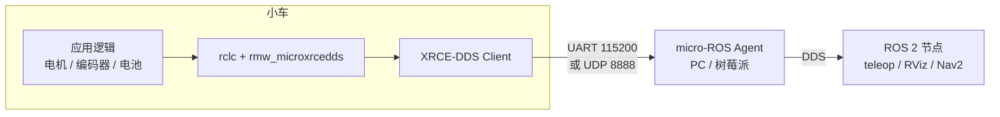
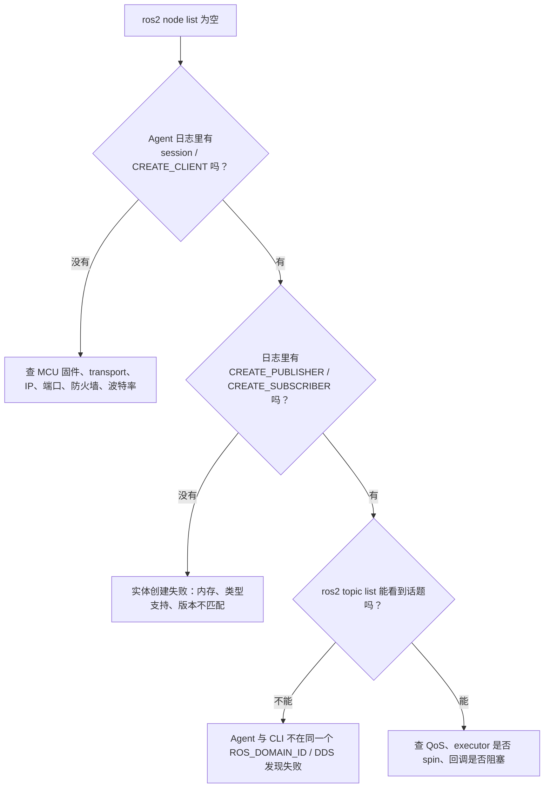

先还原一个很常见的现场：USB 线插好，`micro_ros_agent` 启动，日志刷得飞快，结果 `ros2 node list` 一片空白。于是开始怀疑驱动、怀疑波特率、怀疑 ROS 2 装坏了。

大多数时候，问题不在 Agent，而在链路的另一头：**MCU 上没有跑 micro-ROS 固件，或者跑了但没连上 Agent。** Agent 不是串口驱动，它更像一家翻译公司——公司开着门，客户得自己带着材料上门。

这篇文章就把这条链路从头到尾接一遍：Agent 到底在翻译什么、串口和 Wi-Fi 怎么选、固件怎么写、`cmd_vel` 怎么变成 PWM，以及 `ros2 node list` 为空时到底该查哪。

> **名字先对齐**：本文说的 ROSAgent，指可执行文件 `micro_ros_agent`，官方名称是 **micro-ROS Agent**。它不是 ROS 1 的 `rosbridge_server`，也不是把 MCU 变成 Linux 的模拟器。它做的事情只有一件：在 XRCE-DDS 和 DDS 之间做代理。

本文按 **ROS 2 Jazzy + ESP32** 编写，串口和 Wi-Fi 两条路都会走一遍。轮距、轮径、引脚是示例值，抄代码前先改成你车上的实际参数。



## 1. 先把三个角色摆清楚

很多教程一上来就让你敲 Agent 命令，但没讲清楚谁在跟谁说话。先把角色分开，后面排错会轻松很多。

| 角色 | 跑在哪 | 负责什么 | 不负责什么 |
| --- | --- | --- | --- |
| micro-ROS 客户端库 | 小车 MCU | 用 `rclc` 建节点、话题、定时器，把数据序列化成 XRCE 帧 | 不跑 DDS，不做 DDS 服务发现 |
| 传输层 | 串口 / Wi-Fi / 以太网 | 搬运 XRCE 二进制帧 | 不理解话题，也不保证业务语义 |
| micro-ROS Agent | PC / 树莓派 | 维持 XRCE 会话，在 DDS 里代 MCU 创建实体，转发数据 | 不控制电机，不懂你的业务 |
| ROS 2 节点 | PC | `teleop`、RViz、Nav2 正常收发话题 | 不直接和 MCU 说话 |

打个比方：MCU 是**只懂方言的驻外办事员**，Agent 是**翻译兼代办**。办事员说“我要开一个收件窗口，名字叫 `cmd_vel`”，Agent 就在 DDS 大厅里替他挂一块牌子；之后所有信件由 Agent 转交。办事员不需要会说 DDS，但它得先开口。

这里有一个关键点，理解了它，很多现象就顺了：

> **Agent 不生产数据，它只代理实体。** MCU 不连上来，Agent 再正常，ROS 2 这边也什么都看不到。

所以 `ros2 node list` 不是“Agent 是否启动”的检查，而是“MCU 是否已经在 DDS 里注册了节点”的检查。

## 2. 一条 Twist 消息到底怎么走

把上面的角色连起来，一条控制指令的完整路径是这样的：



具体一点，以键盘控制为例：

1. MCU 上电，`rclc_support_init()` 向 Agent 发起 XRCE 会话。
2. `rclc_node_init_default()` 创建节点 `car_base`，命名空间是 `car`。
3. `rclc_publisher_init_default()` 创建 `/car/odom` 的发布者，`rclc_subscription_init_default()` 创建 `/car/cmd_vel` 的订阅者。
4. Agent 收到这些“创建实体”的请求，在 DDS 里代建对应的 DataWriter / DataReader。此时 `ros2 node list` 才会出现 `/car/car_base`。
5. `teleop_twist_keyboard` 往 `/car/cmd_vel` 发一条 `Twist`，DDS 把它交给 Agent，Agent 再序列化成 XRCE 帧，从串口或 UDP 发给 MCU。
6. MCU 的订阅回调执行，把线速度和角速度拆成左右轮目标；定时器再把里程计发回 `/car/odom`。

注意第 4 步：**话题不是 Agent 配置文件里写死的，是 MCU 启动时动态创建的。** 这也是为什么“Agent 起来了但什么都没发生”特别常见——Agent 只是在等，等 MCU 来注册。

### 串口还是 Wi-Fi？

| 维度 | 串口（UART/USB） | Wi-Fi（UDP） |
| --- | --- | --- |
| 连接方式 | USB 线，点对点 | 同一局域网 |
| 理论带宽 | 115200 8N1 约 11.5 KB/s | 高得多，但共享信道 |
| 延迟与抖动 | 低且稳定 | 受信号、信道、省电策略影响 |
| 适合场景 | 台架调试、短距离、固定线缆 | 小车跑动、远程调试 |
| 常见坑 | 占用烧录口、权限、被串口监视器抢占 | IP 写错、防火墙、AP 隔离、Wi-Fi 省电 |

一个实用建议：**台架上先用串口把链路跑通，再换 Wi-Fi 跑车。** 串口排除了网络变量，出问题时更容易判断是固件还是网络。等 `cmd_vel` 和 `odom` 都正常了，再切 Wi-Fi，心里有底。

## 3. 接线和权限：先排除低级错误

### 3.1 串口方案

把板子插上，先确认系统到底认出了什么：

```bash
lsusb
ls -l /dev/ttyUSB* /dev/ttyACM* 2>/dev/null
ls -l /dev/serial/by-id/ 2>/dev/null
dmesg | tail -20
```

- `ttyUSB0` 通常是 CH340、CP210x 这类 USB 转串口芯片；
- `ttyACM0` 通常是 ESP32-S3、RP2040 等原生 USB CDC；
- `/dev/serial/by-id/` 下的名字带芯片序列号，比 `ttyUSB0` 稳定，建议在启动脚本里用它。

如果 Agent 报 `Permission denied`，把当前用户加进 `dialout` 组：

```bash
sudo usermod -aG dialout $USER
```

这条命令**注销重登后才生效**。不想重登，可以在当前终端临时执行：

```bash
newgrp dialout
```

如果报 `Device or resource busy`，先看谁占着串口：

```bash
sudo lsof /dev/ttyUSB0
```

最常见的是 Arduino 的串口监视器还开着。**烧录和 Agent 不能同时占用同一个串口**：烧录前先停 Agent，烧完再启动 Agent。

有些 Ubuntu 上 `brltty` 会误抓 CH340/CP210x，表现为设备刚插上就被抢走。可以先确认：

```bash
sudo dmesg | grep -i brltty
```

如果确实是它，再考虑停掉对应的 udev 服务。这个服务是给盲文显示器用的，别在不清楚影响的情况下随手卸载。

### 3.2 Wi-Fi 方案

先拿到 PC 在局域网里的地址：

```bash
hostname -I
ip -4 addr show
```

然后把 ESP32 要连的 Agent 地址填成这个地址，**不要填 `127.0.0.1`**。`127.0.0.1` 在 ESP32 上指的是 ESP32 自己，不是你的电脑。

确认两边在同一个网段：

```bash
ping -c 3 <ESP32_IP>
```

如果 PC 开了防火墙，放行 Agent 的 UDP 端口：

```bash
sudo ufw allow 8888/udp
```

几个容易被忽略的点：

- ESP32 大多数型号只支持 **2.4 GHz**，连不上 5 GHz 的 SSID；
- 路由器的“AP 隔离 / 访客网络”会让同一 Wi-Fi 下的设备互相不可见；
- 公司或校园网可能禁止设备间 UDP 通信，台架上最好用自己的路由器；
- 如果 MCU 固件里写死了 Agent IP，给 PC 配 DHCP 保留地址，别让它明天换个 IP。

## 4. 主机侧：把 Agent 跑起来

Agent 的安装方式主要有三种：Docker、源码编译，以及某些发行版提供的二进制包。下面按“最省事”到“最可控”排。

### 4.1 Docker：依赖最干净

官方镜像的标签跟 ROS 2 发行版对应，Jazzy 用 `microros/micro-ros-agent:jazzy`。

串口方式：

```bash
docker run -it --rm \
  --net=host \
  --device=/dev/ttyUSB0 \
  -e ROS_DOMAIN_ID=0 \
  microros/micro-ros-agent:jazzy \
  serial --dev /dev/ttyUSB0 -b 115200 -v6
```

Wi-Fi / UDP 方式：

```bash
docker run -it --rm \
  --net=host \
  -e ROS_DOMAIN_ID=0 \
  microros/micro-ros-agent:jazzy \
  udp4 --port 8888 -v6
```

参数逐个解释：

| 参数 | 作用 |
| --- | --- |
| `--net=host` | 共享宿主机网络，DDS 发现和 UDP 收包都最省事 |
| `--device=/dev/ttyUSB0` | 只把需要的串口暴露给容器，比 `--privileged` 克制 |
| `-e ROS_DOMAIN_ID=0` | 和宿主机上的 ROS 2 命令保持一致 |
| `-v6` | 最高级别日志，排错时用；日常可以降到 `-v4` |

如果串口是 `ttyACM0`，把两处 `ttyUSB0` 都换掉。`--device` 只暴露一个设备，容器里看到的路径和宿主机一致。

如果你平时用 `export ROS_DOMAIN_ID=42` 把话题隔离开，Agent 进程也必须在同一个 domain。Docker 方案用 `-e ROS_DOMAIN_ID=42`，源码方案在启动前 `export ROS_DOMAIN_ID=42`；两边不一致时，`ros2 node list` 就是空的。

### 4.2 源码编译：需要改代码或查问题时用

先确认源里有没有现成的包，有就省事：

```bash
apt-cache policy ros-$ROS_DISTRO-micro-ros-agent
```

没有的话，从源码编：

```bash
mkdir -p ~/microros_ws/src
cd ~/microros_ws/src
git clone -b jazzy https://github.com/micro-ROS/micro-ROS-Agent.git

cd ~/microros_ws
rosdep install --from-paths src --ignore-src -y
colcon build --packages-select micro_ros_agent --cmake-args -DCMAKE_BUILD_TYPE=Release

source install/setup.bash
ros2 run micro_ros_agent micro_ros_agent udp4 --port 8888 -v6
```

第一次编译会连带构建 Fast DDS 等依赖，时间比较长，别在跑到一半时以为卡死了。`-b jazzy` 要和你的 ROS 2 发行版对应；Humble 就换成 `humble`。

官方也提供 snap 包，但串口场景有已知问题，本文不展开。串口优先 Docker 或源码。

### 4.3 Agent 的常用参数

| 场景 | 命令 |
| --- | --- |
| 串口 | `micro_ros_agent serial --dev /dev/ttyUSB0 -b 115200` |
| UDP IPv4 | `micro_ros_agent udp4 --port 8888` |
| TCP IPv4 | `micro_ros_agent tcp4 --port 2018` |
| 提高日志级别 | 追加 `-v6` |
| 查看全部参数 | `micro_ros_agent --help` |

有一个细节值得单独说：**`-b` 必须和固件里的串口波特率一致。** `micro_ros_arduino` 的默认串口传输在库内部把波特率写成了 `115200`，所以 Agent 这边也写 `115200`。想把波特率提到 921600，不是改 Agent 的 `-b` 就行，还得改固件的传输实现；否则两边对不上，日志里只会看到一堆乱码或超时。

## 5. 单片机侧：先让 Agent 看见心跳

不要一上来就写电机 PID。先让 ROS 2 看见一个话题，确认链路通了，再往上叠控制。这样出问题时，你知道该查通信还是查电机。

### 5.1 Arduino 环境准备

1. 在 Arduino IDE 里装好 ESP32 的开发板支持；
2. 在库管理器里安装 `micro_ros_arduino`，版本尽量和上位机的 ROS 2 发行版对齐（库的 `library.properties` 里会带 `jazzy`、`humble` 之类的后缀）；
3. 选择对应的开发板型号和串口；
4. 如果编译报 `Sketch too big`，换一个更大的 APP 分区方案；
5. 串口方案下，烧录完先关掉串口监视器，再把串口交给 Agent。

### 5.2 最小心跳固件

下面这段只做一件事：创建一个节点，每秒发布一次 `/car/heartbeat`。它不碰电机，适合用来验证 Agent、传输和命名空间。

```cpp
#include <micro_ros_arduino.h>
#include <rcl/rcl.h>
#include <rclc/rclc.h>
#include <rclc/executor.h>
#include <std_msgs/msg/int32.h>

rcl_publisher_t heartbeat_pub;
rclc_support_t support;
rcl_allocator_t allocator;
rcl_node_t node;
rcl_timer_t timer;
rclc_executor_t executor;
std_msgs__msg__Int32 heartbeat_msg;

#define RCCHECK(fn) do { \
  rcl_ret_t rc = (fn); \
  if (rc != RCL_RET_OK) { error_loop(); } \
} while (0)

void error_loop() {
  while (true) {
    digitalWrite(LED_BUILTIN, !digitalRead(LED_BUILTIN));
    delay(100);
  }
}

void timer_callback(rcl_timer_t * timer, int64_t last_call_time) {
  (void) last_call_time;
  if (timer == nullptr) return;
  heartbeat_msg.data++;
  rcl_publish(&heartbeat_pub, &heartbeat_msg, nullptr);
}

void setup() {
  // Wi-Fi 方案下 Serial 可以留作调试；串口方案下这几行要删掉
  Serial.begin(115200);
  Serial.println("Wi-Fi connecting...");

  // Wi-Fi：SSID、密码、上位机 IP、Agent UDP 端口
  char ssid[] = "YOUR_WIFI";
  char pass[] = "YOUR_PASS";
  char agent_ip[] = "192.168.1.100";
  set_microros_wifi_transports(ssid, pass, agent_ip, 8888);

  // 串口方案改成下面这一行（默认 115200）：
  // set_microros_transports();

  Serial.print("ESP32 IP: ");
  Serial.println(WiFi.localIP());

  pinMode(LED_BUILTIN, OUTPUT);

  allocator = rcl_get_default_allocator();
  RCCHECK(rclc_support_init(&support, 0, nullptr, &allocator));
  RCCHECK(rclc_node_init_default(&node, "car_base", "car", &support));

  RCCHECK(rclc_publisher_init_default(
    &heartbeat_pub, &node,
    ROSIDL_GET_MSG_TYPE_SUPPORT(std_msgs, msg, Int32),
    "heartbeat"));

  heartbeat_msg.data = 0;
  RCCHECK(rclc_timer_init_default(
    &timer, &support, RCL_MS_TO_NS(1000), timer_callback));

  RCCHECK(rclc_executor_init(&executor, &support.context, 1, &allocator));
  RCCHECK(rclc_executor_add_timer(&executor, &timer));
}

void loop() {
  rclc_executor_spin_some(&executor, RCL_MS_TO_NS(10));
  delay(10);
}
```

几个关键点：

- `rclc_node_init_default(&node, "car_base", "car", &support)` 里的第三个参数是命名空间。节点全名是 `/car/car_base`，话题会落在 `/car/` 下。
- `rclc_publisher_init_default` 用的是默认 QoS（可靠传输）。先用默认值，别一上来就调 QoS。
- `rclc_executor_spin_some()` 必须被反复调用。回调不是硬件中断，不会自己跑。
- `set_microros_wifi_transports()` 内部会阻塞等待 Wi-Fi 连上。密码错、SSID 不存在、5 GHz 连不上，程序就停在这里，表现为“板子像死机”。台架上可以先打开串口看它卡在哪。
- 串口方案下 `Serial` 已经被 micro-ROS 占用，代码里的 `Serial.print` 要去掉，否则会干扰 XRCE 数据。

烧录后，在 PC 上验证：

```bash
ros2 node list
```

正常的话能看到：

```text
/car/car_base
```

再看话题：

```bash
ros2 topic list -t
```

```text
/car/heartbeat [std_msgs/msg/Int32]
```

然后看数据：

```bash
ros2 topic echo /car/heartbeat
```

```text
data: 1
---
data: 2
---
```

最后确认频率：

```bash
ros2 topic hz /car/heartbeat
```

应该接近 1 Hz。**如果这一步不通，先别写电机代码。** 通信链路和电机控制混在一起调，最后往往两个都调不出来。

## 6. 接上电机：从 `/cmd_vel` 到 PWM

链路通了，接下来才是小车。ROS 2 这边约定俗成地用 `geometry_msgs/msg/Twist` 控制底盘：

- `linear.x`：前进速度，单位 m/s；
- `angular.z`：绕 z 轴的角速度，单位 rad/s，逆时针为正；
- 坐标系遵循 REP-103：x 向前、y 向左、z 向上。

差速小车把 `(v, ω)` 拆成左右轮线速度：

```text
v_left  = v - ω · L / 2
v_right = v + ω · L / 2
```

其中 `L` 是轮距。再除以轮半径 `r`，得到左右轮的角速度：

```text
ω_left  = v_left  / r
ω_right = v_right / r
```

代入一组数感受一下：`v = 0.2 m/s`、`ω = 0`、`L = 0.17 m`、`r = 0.0325 m`，左右轮角速度都约等于 `6.15 rad/s`，车直行。如果 `ω = 1.0 rad/s`，左轮约 `3.54 rad/s`，右轮约 `8.77 rad/s`，车左转——左轮慢、右轮快，方向是对的。

### 6.1 在心跳固件上继续加

下面的代码接在上一节的文件里。先加头文件和全局对象：

```cpp
#include <math.h>
#include <string.h>
#include <geometry_msgs/msg/twist.h>
#include <nav_msgs/msg/odometry.h>
#include <rmw_microros/rmw_microros.h>

rcl_subscription_t cmd_sub;
rcl_publisher_t odom_pub;
geometry_msgs__msg__Twist cmd_msg;
nav_msgs__msg__Odometry odom_msg;
rcl_timer_t control_timer;

const float WHEEL_RADIUS = 0.0325f;   // 轮半径，m
const float WHEEL_TRACK  = 0.170f;    // 轮距，m
const float MAX_WHEEL_W  = 20.0f;     // 单轮最大角速度，rad/s
const uint32_t CMD_TIMEOUT_MS = 500;  // 多久没收到 cmd_vel 就停车

float target_left = 0.0f;
float target_right = 0.0f;
uint32_t last_cmd_ms = 0;
float pose_x = 0.0f, pose_y = 0.0f, pose_yaw = 0.0f;

char odom_frame[] = "odom";
char base_frame[] = "base_link";
```

`apply_motor()` 是硬件相关部分，先留成空函数，后面按你的电机驱动补：

```cpp
void apply_motor(float left_rad_s, float right_rad_s) {
  (void) left_rad_s;
  (void) right_rad_s;
  // TODO: 角速度 -> PWM，处理方向、死区、限幅和刹车
}
```

订阅回调和定时器回调：

```cpp
void cmd_vel_callback(const void * msgin) {
  const auto * msg = static_cast<const geometry_msgs__msg__Twist *>(msgin);
  const float v = msg->linear.x;
  const float w = msg->angular.z;

  target_left  = (v - w * WHEEL_TRACK * 0.5f) / WHEEL_RADIUS;
  target_right = (v + w * WHEEL_TRACK * 0.5f) / WHEEL_RADIUS;

  // 限幅，别让一条异常指令把电机拉满
  if (target_left  >  MAX_WHEEL_W) target_left  =  MAX_WHEEL_W;
  if (target_left  < -MAX_WHEEL_W) target_left  = -MAX_WHEEL_W;
  if (target_right >  MAX_WHEEL_W) target_right =  MAX_WHEEL_W;
  if (target_right < -MAX_WHEEL_W) target_right = -MAX_WHEEL_W;

  last_cmd_ms = millis();
}

void control_callback(rcl_timer_t * timer, int64_t last_call_time) {
  (void) last_call_time;
  if (timer == nullptr) return;

  // 超时保护：上位机掉线、Wi-Fi 抖动、teleop 关掉，都必须停车
  if (millis() - last_cmd_ms > CMD_TIMEOUT_MS) {
    target_left = 0.0f;
    target_right = 0.0f;
  }

  apply_motor(target_left, target_right);

  // 开环里程计：只用目标速度积分，仅供联调；真车请换成编码器测速
  const float dt = 0.05f;
  const float v = (target_left + target_right) * 0.5f * WHEEL_RADIUS;
  const float w = (target_right - target_left) * WHEEL_RADIUS / WHEEL_TRACK;

  pose_x += v * cosf(pose_yaw) * dt;
  pose_y += v * sinf(pose_yaw) * dt;
  pose_yaw += w * dt;
  if (pose_yaw > PI) pose_yaw -= 2.0f * PI;
  if (pose_yaw < -PI) pose_yaw += 2.0f * PI;

  const int64_t ns = rmw_uros_epoch_nanos();
  odom_msg.header.stamp.sec = static_cast<int32_t>(ns / 1000000000LL);
  odom_msg.header.stamp.nanosec = static_cast<uint32_t>(ns % 1000000000LL);
  odom_msg.pose.pose.position.x = pose_x;
  odom_msg.pose.pose.position.y = pose_y;
  odom_msg.pose.pose.orientation.z = sinf(pose_yaw * 0.5f);
  odom_msg.pose.pose.orientation.w = cosf(pose_yaw * 0.5f);
  odom_msg.twist.twist.linear.x = v;
  odom_msg.twist.twist.angular.z = w;

  rcl_publish(&odom_pub, &odom_msg, nullptr);
}
```

然后在 `setup()` 里，把上一节创建心跳发布者和心跳定时器的那几行删掉，换成下面这一段。注意 `executor` 的句柄数从 1 改成了 2，因为现在有一个订阅和一个定时器。如果你想保留心跳，就把句柄数改成 3，并在后面继续 `add_timer`；下面的例子只保留 `cmd_vel` 和 `odom`：

```cpp
void setup_entities() {
  odom_msg.header.frame_id.data = odom_frame;
  odom_msg.header.frame_id.size = strlen(odom_frame);
  odom_msg.header.frame_id.capacity = sizeof(odom_frame);

  odom_msg.child_frame_id.data = base_frame;
  odom_msg.child_frame_id.size = strlen(base_frame);
  odom_msg.child_frame_id.capacity = sizeof(base_frame);

  // 协方差先给一组经验值，真车要按编码器和 IMU 的噪声重调
  odom_msg.pose.covariance[0] = 0.02f;
  odom_msg.pose.covariance[7] = 0.02f;
  odom_msg.pose.covariance[35] = 0.05f;
  odom_msg.twist.covariance[0] = 0.02f;
  odom_msg.twist.covariance[35] = 0.05f;

  RCCHECK(rclc_subscription_init_default(
    &cmd_sub, &node,
    ROSIDL_GET_MSG_TYPE_SUPPORT(geometry_msgs, msg, Twist),
    "cmd_vel"));

  RCCHECK(rclc_publisher_init_default(
    &odom_pub, &node,
    ROSIDL_GET_MSG_TYPE_SUPPORT(nav_msgs, msg, Odometry),
    "odom"));

  RCCHECK(rclc_timer_init_default(
    &control_timer, &support, RCL_MS_TO_NS(50), control_callback));

  RCCHECK(rclc_executor_init(&executor, &support.context, 2, &allocator));
  RCCHECK(rclc_executor_add_subscription(
    &executor, &cmd_sub, &cmd_msg, &cmd_vel_callback, ON_NEW_DATA));
  RCCHECK(rclc_executor_add_timer(&executor, &control_timer));
}
```

`setup()` 里的顺序也要调整一下：先建会话，再同步一次时间，最后创建实体。

```cpp
allocator = rcl_get_default_allocator();
RCCHECK(rclc_support_init(&support, 0, nullptr, &allocator));

// 让 MCU 的时间戳变成 Unix 时间；失败也不阻塞启动，但 odom 时间戳可能是 0
if (!rmw_uros_sync_session(1000)) {
  // 可以在这里闪灯提示，串口方案下不要用 Serial 打印
}

RCCHECK(rclc_node_init_default(&node, "car_base", "car", &support));
setup_entities();
```

这里有几个设计取舍，值得说明白：

- **`cmd_vel` 回调只做换算和限幅，不直接驱动电机。** 真正输出 PWM 放在 20 Hz 的定时器里，这样即使上位机突然不发指令，定时器仍然能执行超时停车。
- **开环里程计是故意的。** 先用目标速度积分，能把 `/car/odom` 的通路和 RViz 显示跑通；但它不知道轮子有没有打滑、有没有被挡住，不能拿去做 Nav2 的定位。真车要换成编码器测速，再用同一套消息发出去。
- **`frame_id` 和 `child_frame_id` 是字符串字面量。** micro-ROS 没有 `std::string`，字符串要自己填 `data / size / capacity`。这里指向全局数组，生命周期贯穿整个程序，所以是安全的。
- **`dt` 固定成 0.05 s**，对应 50 ms 定时器。严格做法是用 `last_call_time` 算真实间隔，但固定值足够先把链路跑通；如果定时器抖动明显，再改成实际间隔。
- **超时时间 500 ms** 是联调值。真车可以更短，比如 200–300 ms；但太短会因为 Wi-Fi 抖动频繁停车。

### 6.2 用键盘试一下

先把小车架空，轮子离地，再跑：

```bash
ros2 run teleop_twist_keyboard teleop_twist_keyboard \
  --ros-args -r cmd_vel:=/car/cmd_vel
```

按键说明：`i` 前进，`,` 后退，`j` 左转，`l` 右转，`k` 停车。先看轮子转向对不对，再落地。

验证话题：

```bash
ros2 topic echo /car/cmd_vel --once
ros2 topic echo /car/odom --once
ros2 topic hz /car/odom
```

`/car/odom` 应该接近 20 Hz。如果只有几 Hz，先怀疑串口带宽、Wi-Fi 丢包，或者 `apply_motor()` 里有阻塞操作。

RViz 里可以这样看：

- Fixed Frame 填 `odom`；
- Add → Odometry → Topic 选 `/car/odom`；
- 只看里程计箭头时，Fixed Frame 和消息里的 `frame_id` 都填 `odom`，不依赖额外的坐标变换；但要让 RViz 的 TF 树完整、显示 RobotModel，就必须有 `odom -> base_link` 的 TF。

这里有个常见的错误：**不要用 `static_transform_publisher` 把 `odom -> base_link` 固定住。** 静态变换不会跟着里程计走，模型会永远停在原点。正确做法是让 TF 跟着 `/car/odom` 更新：可以在主机上写一个小节点订阅 `/car/odom` 并广播 TF，也可以让 MCU 直接发 `tf2_msgs/msg/TFMessage`。前者让 MCU 更轻，后者链路更短，按你的系统选。

## 7. `ros2 node list` 为空，到底查哪

先把排查顺序画出来，别一头扎进驱动重装：



把常见现象整理成表：

| 现象 | 最可能的原因 | 先查什么 |
| --- | --- | --- |
| `ros2 node list` 空，Agent 也没日志 | 固件没跑 / 传输没选对 / 线没接好 | 板子是否在跑；`set_microros_*` 是否被执行到 |
| Agent 有 session，但没有 node | 实体创建失败、内存不足、版本不匹配 | Agent 日志里的 `CREATE_CLIENT` / `CREATE_PUBLISHER`；固件和 Agent 的发行版 |
| 有 node，但话题没数据 | executor 没 spin、回调阻塞、QoS 不兼容 | `ros2 topic info /car/odom -v`；`ros2 topic echo /car/odom --qos-reliability best_effort` |
| `Permission denied` | 当前用户不在 `dialout` 组 | `groups`；`sudo usermod -aG dialout $USER` |
| `Device or resource busy` | 串口监视器 / 另一个 Agent / brltty | `sudo lsof /dev/ttyUSB0` |
| 连上几秒就掉 | Wi-Fi 省电、信号弱、IP 变了、Agent 重启 | `WiFi.setSleep(false)`；DHCP 保留；Agent 日志 |
| 时间戳是 0 / TF 报 extrapolation | 没做时间同步 | `rmw_uros_sync_session()` 的返回值 |
| 频率低、控制延迟大 | 串口带宽、Wi-Fi 重传、`-v6` 日志、回调阻塞 | `ros2 topic hz`；先降到 `-v4`；检查 `apply_motor()` |
| 一给 `cmd_vel` 就重启 | 电机供电不足、电源干扰、欠压复位 | 电机电源和 MCU 电源是否分开；信号地是否共地 |
| Docker 里 Agent 正常，外面看不到 | 没加 `--net=host`、`ROS_DOMAIN_ID` 不一致 | `docker run` 参数；两边环境变量 |

几个补充：

- **Agent 启动晚于 MCU**：如果固件没有重连逻辑，MCU 启动时连不上就一直卡着。先启动 Agent，再复位 MCU，是最简单的验证方法。
- **`ros2 daemon` 缓存了旧图**：换过网络或 Agent 后，执行 `ros2 daemon stop`，再重新 `ros2 node list`。
- **DDS 发现失败**：默认发现依赖组播，VPN、虚拟机 NAT、公司网络经常把它掐掉。台架上尽量让 Agent 和 ROS 2 命令在同一台机器上；跨机器时确认两端在同一个 `ROS_DOMAIN_ID`，并且网络允许组播或已配置单播发现。
- **`-v6` 不是万能的**：它能把 XRCE 的创建过程打出来，但日志本身也会影响时序。定位到问题后降回 `-v4`。

## 8. 让它稳：重连、时间、QoS 和安全

链路能通只是第一步。小车跑起来之后，Wi-Fi 会抖、Agent 会重启、电池会掉压，这些都不是“异常”，而是常态。

### 8.1 断线重连

`micro_ros_arduino` 自带一个重连示例，核心是一个状态机：

```cpp
enum State {
  WAITING_AGENT,
  AGENT_AVAILABLE,
  AGENT_CONNECTED,
  AGENT_DISCONNECTED
};
```

连接前用 `rmw_uros_ping_agent(100, 1)` 探测 Agent；连上之后定期 ping，失败就销毁实体、回到等待状态。关键不是这段 `switch` 本身，而是两件事：

1. **断线时先把电机停掉，再重建实体。** 不要让 `rcl_publish()` 的失败阻塞控制循环。
2. **实体要销毁再重建。** Agent 重启后，旧的 XRCE 会话和实体已经不存在了，只重连 transport 不重建实体，ROS 2 这边仍然看不到节点。

`ping_agent()` 会阻塞到超时，别在每个控制周期里都调用。用 200–500 ms 的节流，或者放到单独的定时器里。

### 8.2 时间同步

MCU 上电后的时钟是“开机了多久”，不是 Unix 时间。`Odometry.header.stamp` 如果填的是开机时间，RViz 和 TF 会把它当成 1970 年附近的时间，表现为数据“太旧”或 extrapolation 报错。

在 `rclc_support_init()` 之后调用一次：

```cpp
rmw_uros_sync_session(1000);
```

之后用 `rmw_uros_epoch_nanos()` 取时间戳。Agent 会把自己的时钟同步给 MCU，所以主机本身要开着 NTP；主机时间不对，MCU 也不会对。重连之后要重新同步一次。

### 8.3 QoS：别让旧指令在恢复后“补刀”

QoS 不匹配是“话题能看到、就是没数据”的常见原因。几个实用原则：

- 高频传感器数据（IMU、里程计）可以用 `best_effort`，丢一帧比堵住链路好；
- 控制指令用可靠传输，但队列要小，`keep_last` 1–10 就够；
- MCU 发 `best_effort` 时，`ros2 topic echo` 默认的可靠订阅会收不到，要加 `--qos-reliability best_effort`；
- **可靠传输不等于安全**：网络恢复后，队列里积压的旧 `cmd_vel` 可能被补发。真正的安全边界是 MCU 侧的超时停车和限幅，不是 QoS。

查看两端 QoS 是否兼容：

```bash
ros2 topic info /car/cmd_vel -v
```

### 8.4 带宽和延迟

115200 8N1 的理论吞吐是 `115200 / 10 = 11520 B/s`，再扣掉 XRCE 帧头和 DDS 序列化开销，实际可用更低。一条 `Twist` 很小，20 Hz 没问题；但如果你把摄像头图像、点云往 micro-ROS 里塞，串口会立刻成为瓶颈。

几个降低延迟的办法：

- 串口台架够用，跑车优先 Wi-Fi；
- Wi-Fi 下在固件里关掉省电：`WiFi.setSleep(false);`，代价是功耗上升；
- Agent 日常用 `-v4`，别长期 `-v6`；
- 里程计 20–50 Hz 足够，没必要 200 Hz；
- 图像和点云交给板载算力或另一台机载电脑，不要走 MCU。

### 8.5 安全边界

默认配置下，XRCE-DDS 链路没有加密和鉴权。也就是说，同一个网络里能连到 Agent 的人，理论上可以创建实体、发 `cmd_vel`。这不是 micro-ROS 独有的问题，但做小车的人容易忽略。

最低限度：

- 不要把 Agent 的 UDP 端口暴露到公网；
- 用独立的局域网或 VPN，别和办公网混在一起；
- MCU 侧对 `cmd_vel` 做限幅、斜率限制和超时停车；
- 车上留一个物理急停或电机电源开关，软件失联时能断电。

## 9. 把它变成一条命令

调通之后，每次都手敲一长串 Agent 命令很烦。可以写一个 launch 文件：

```python
from launch import LaunchDescription
from launch_ros.actions import Node


def generate_launch_description():
    return LaunchDescription([
        Node(
            package='micro_ros_agent',
            executable='micro_ros_agent',
            name='micro_ros_agent',
            output='screen',
            arguments=['serial --dev /dev/ttyUSB0 -b 115200 -v 4'],
        ),
    ])
```

注意 `arguments` 里是**一个带空格的字符串**，不是 `['serial', '--dev', ...]`。`micro_ros_agent` 的 `main()` 对 launch 做了特殊处理：它会在 `--ros-args` 之前把这一整串再拆开。拆成多个列表元素反而会触发它的参数检查。

如果要开机自启，可以用 systemd。下面是一个 UDP 版本的例子：

```ini
[Unit]
Description=micro-ROS Agent (UDP 8888)
After=network-online.target
Wants=network-online.target

[Service]
Environment=ROS_DOMAIN_ID=0
ExecStart=/bin/bash -lc 'source /opt/ros/jazzy/setup.bash && exec ros2 run micro_ros_agent micro_ros_agent udp4 --port 8888 -v4'
Restart=always
RestartSec=2

[Install]
WantedBy=multi-user.target
```

```bash
sudo systemctl daemon-reload
sudo systemctl enable --now micro-ros-agent.service
journalctl -u micro-ros-agent -f
```

串口版本建议把 `/dev/ttyUSB0` 换成 `/dev/serial/by-id/...`，避免重新插拔后编号从 `ttyUSB0` 变成 `ttyUSB1`。

## 10. 验收清单

把下面这些逐条打勾，基本就说明链路是可靠的，而不是“碰巧通了一次”：

- [ ] `ros2 node list` 能看到 `/car/car_base`
- [ ] `ros2 topic list -t` 里话题类型正确
- [ ] `/car/heartbeat` 频率稳定，`/car/odom` 接近 20 Hz
- [ ] `teleop_twist_keyboard` 能控制前进、后退、转向
- [ ] 松开按键或关掉 teleop，500 ms 内电机停转
- [ ] 拔掉 Wi-Fi / 串口，电机停转；插回后能重连并重新出现节点
- [ ] RViz 里 `odom` 箭头方向与实际运动一致
- [ ] `ros2 topic echo /car/odom` 的时间戳不是 0
- [ ] Agent 重启后，MCU 能销毁并重建实体
- [ ] 电机电源和 MCU 电源分开，急停可用

## 最后

micro-ROS Agent 的价值，不是让 MCU 跑起完整的 ROS 2，而是让 MCU 的实体被 ROS 2 看见。它像一扇门：门内是几百 KB 的单片机，门外是整个 ROS 2 生态。门能不能稳住，靠的不是 Agent 一个进程，而是波特率、IP、QoS、超时停车和重连逻辑这些不太性感的东西。

如果只能记住三件事：

1. **Agent 跑在主机上**，不在小车上；
2. **MCU 必须跑 micro-ROS 固件**，Agent 不会替它创建节点；
3. **两边的传输参数必须对齐**：串口看端口和波特率，Wi-Fi 看 IP、端口和防火墙。

把这三件事对齐，`ros2 node list` 里就会出现那行 `/car/car_base`。那一刻，几百 KB 的单片机就正式成了 ROS 2 网络里的一个节点。

> 说明：本文按 ROS 2 Jazzy + ESP32 的通用路径编写，引脚、轮距、轮径和电机驱动需要按你的小车修改；代码里的 `apply_motor()` 是待补全的硬件钩子。文中命令用于说明链路和排查方法，未在你的实车环境执行。
