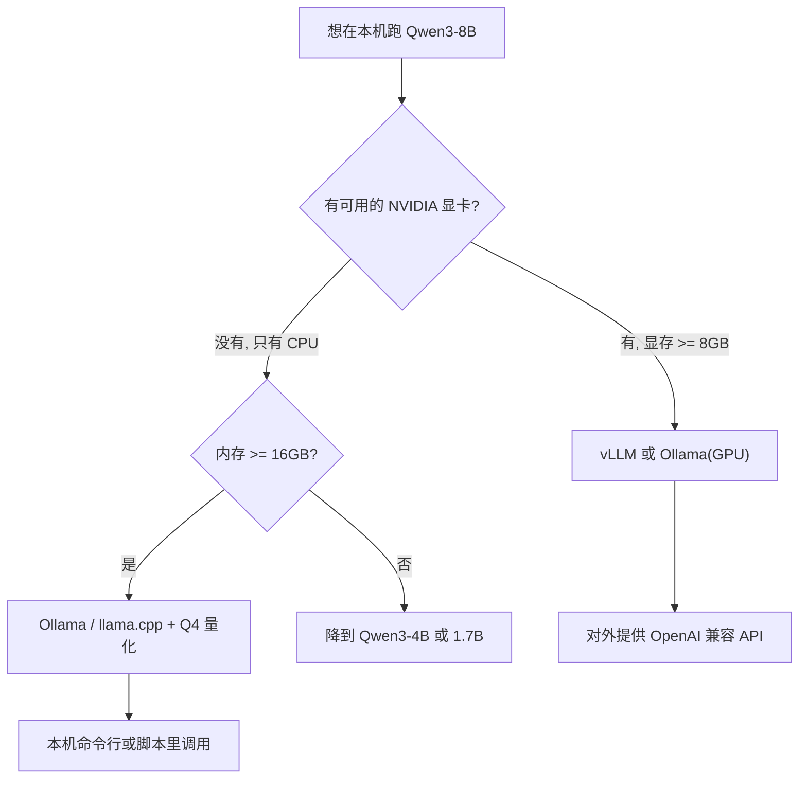
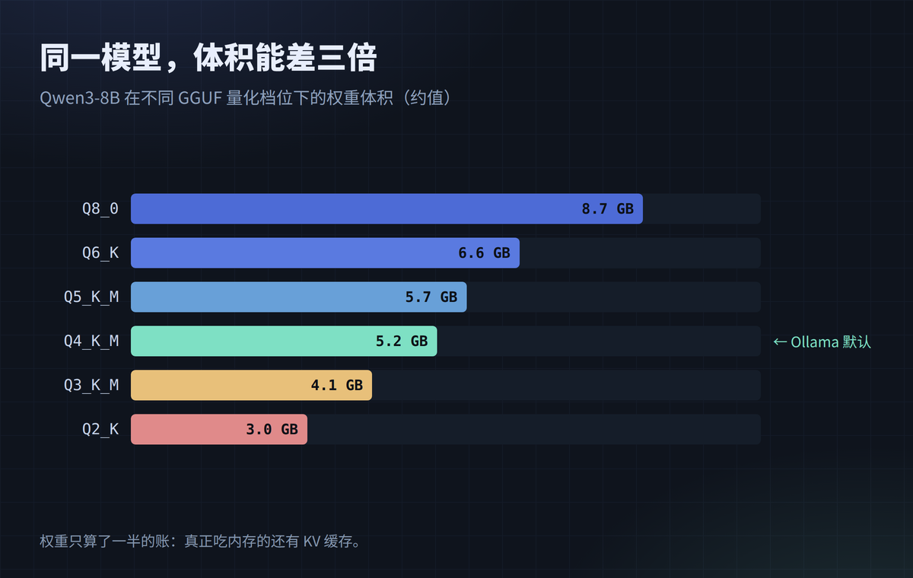
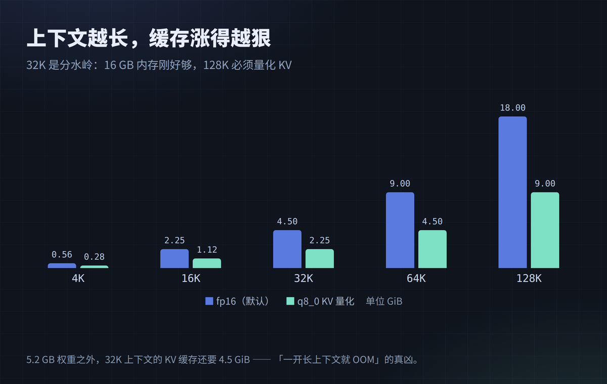
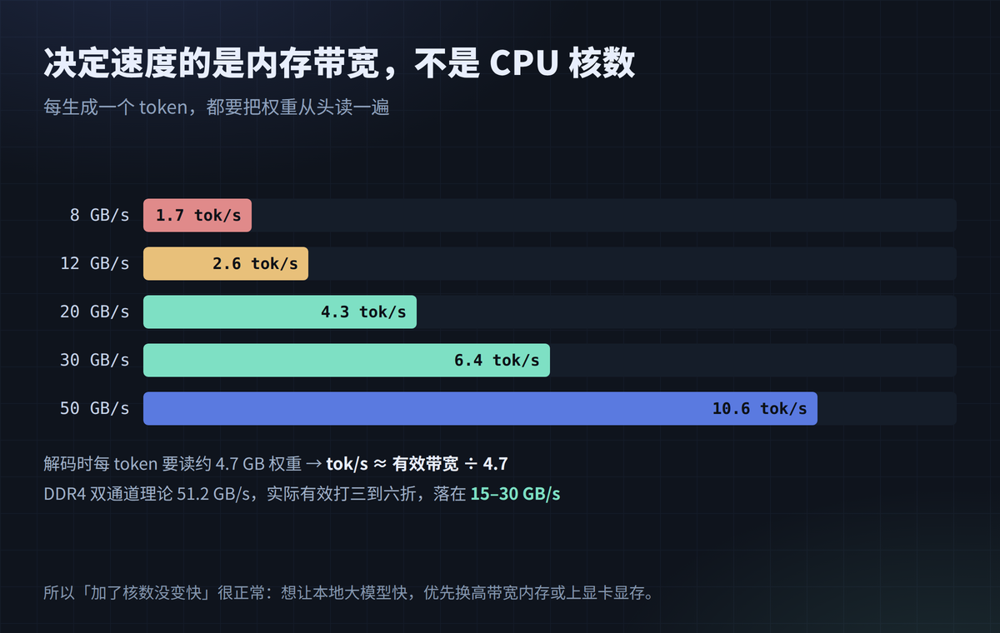
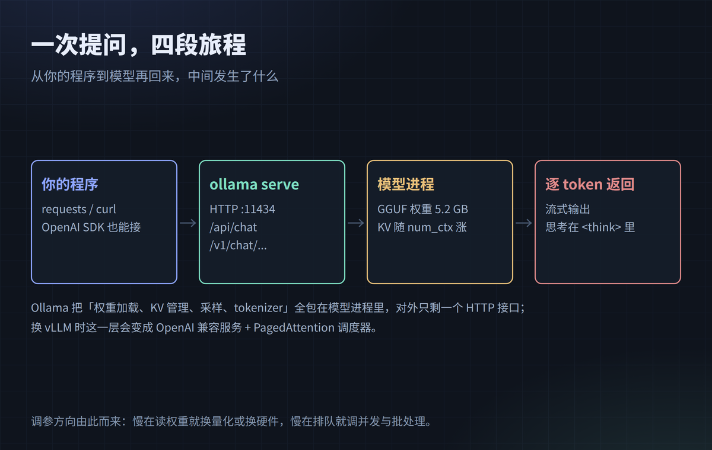

想让它读自己电脑里的文档，又不想把文档传到别人的服务器上 —— 本地部署大模型的真实动机，八成不是省钱，而是**数据不出门**。

网上教程通常就三行：装 Ollama、`ollama pull qwen3:8b`、`ollama run qwen3:8b`。这三行没错，但我真在自己机器上照做时，卡住的从来不是这三行：

- 机器上根本没有 `ollama`，也没有 llama.cpp、vLLM；
- `nvidia-smi` 直接报驱动不可用，教程里那句"GPU 加速"对我是空的；
- 模型文件 5.2 GB，实测下载速度 1.8–2.6 MB/s，光拉权重就要四十分钟。

所以这篇文章不写"三条命令跑通"，而是把顺序倒过来：**先算清你的机器够不够，再决定装哪个、怎么调**。

先给结论：**8B 级别的 Qwen3 是单机部署的甜点尺寸** —— Q4 量化后权重约 5.2 GB，32K 上下文的 KV 缓存约 4.5 GB（fp16），一台 16 GB 内存的普通电脑就能跑；但**没有显卡时，它是"离线小助手"，不是"本地版 ChatGPT"**。

## 一、先确认你要部署的是哪个模型

"千问3.8" 通常指 Qwen3 系列的 8B 版本，也就是 Qwen3-8B。它的规格不是营销数字，而是直接决定你能不能跑的硬参数：

| 项目 | 值 | 为什么值得关心 |
| --- | --- | --- |
| 参数量 | 8.2B（dense，非 MoE） | 决定权重大小与每 token 的计算量 |
| 层数 / 隐藏维度 | 36 / 4096 | 决定 KV 缓存按层累加的规模 |
| 注意力 | 32 个 Q 头 + **8 个 KV 头**（GQA，head_dim 128） | KV 头只有 Q 头的 1/4，缓存直接省四倍 |
| 词表 | 151936 | 影响首 token 与多语言表现 |
| 原生上下文 | 32768（YaRN ×4 可扩到 131072） | 想喂长文档必须显式开启 |
| 原始精度 | bf16 | 全精度权重约 16 GB，几乎没人这么跑 |
| 许可 | Apache-2.0 | 可商用，不必逐案申请 |
| 特色 | thinking / non-thinking 双模式，**默认 thinking** | 直接决定你感受到的"快慢" |

数据取自 Qwen 官方模型卡（<https://huggingface.co/Qwen/Qwen3-8B>）与仓库里的 `config.json`。

这里有个容易被忽略的点：**8 个 KV 头**。GQA（分组查询注意力）让多个 Q 头共享一组 K/V，代价是表达力略降，收益是 KV 缓存只有标准多头注意力的四分之一。后面算内存那一节，这个"8"就是关键分母。

## 二、三条路：Ollama、llama.cpp、vLLM

本地跑模型不是只有一种装法。选错工具，后面全是别扭：

| 方案 | 适合谁 | 权重格式 | 并发能力 | 上手成本 |
| --- | --- | --- | --- | --- |
| **Ollama** | 个人电脑、内网原型、想十分钟看到效果 | GGUF | 弱（默认串行，可调 `num_parallel`） | 最低，一条脚本 |
| **llama.cpp** | 要把推理嵌进自己的 C++/Python 程序、要抠每一个参数 | GGUF | 弱到中（`llama-server` 可多槽） | 中，需要自己编译 |
| **vLLM** | 有 NVIDIA 显卡、要给多人/多服务提供 API | safetensors / AWQ / GPTQ | 强（PagedAttention + 连续批处理） | 高，要 CUDA 环境 |

决策其实很干脆：



我自己的机器是 20 核 CPU、23 GiB 内存、`nvidia-smi` 起不来，所以本文的主线是 **CPU + Ollama**，vLLM 只做对照说明。

## 三、跑之前先算三笔账

装之前先算账，能省掉"下完 5 GB 才发现跑不动"的崩溃。

### 3.1 第一笔：权重账

同一个模型，量化等级不同，体积能差三倍：

| 量化 | 权重体积（约） | 质量感受 | 适合场景 |
| --- | --- | --- | --- |
| Q8_0 | 8.7 GB | 几乎无损 | 内存充裕，做基准对比 |
| Q6_K | 6.6 GB | 很接近原版 | 16 GB 以上内存的主力 |
| Q5_K_M | 5.7 GB | 损失可感知但小 | 折中选择 |
| **Q4_K_M** | **5.2 GB** | 通用推荐档 | Ollama 默认给的就是这一档 |
| Q3_K_M | 4.1 GB | 明显掉点，尤其数学与代码 | 内存吃紧时保命 |
| Q2_K | 3.0 GB | 会开始胡说 | 只适合"能跑就行"的演示 |

Ollama 的 `qwen3:8b` 标签对应的就是 Q4_K_M 级别：我直接查了它的 registry manifest，模型层 5225.4 MB，合计 5.23 GB。这个数字和上表能对上，说明官方打包没有偷偷换档。



*图 1 · 同一份权重，量化档位不同，体积能差近三倍。绿色那根（Q4_K_M）是性价比档，也是 Ollama 默认给的那一档。*

### 3.2 第二笔：KV 缓存账（最容易被忽略）

很多人只算权重，结果 32K 上下文一开就 OOM。KV 缓存的大小是可以精确算出来的：

```
每 token 缓存元素数 = 2 × 层数 × KV头数 × head_dim
                   = 2 × 36 × 8 × 128
                   = 73728 个数
```

用一段脚本把它换算成内存：

```python
layers, kv_heads, head_dim = 36, 8, 4096 // 32   # head_dim = 128
per_token = 2 * layers * kv_heads * head_dim
print("每 token KV 元素数:", per_token)          # 73728

for name, bytes_per in [("fp16", 2), ("q8_0", 1), ("q4_0", 0.5)]:
    for ctx in (4096, 32768, 131072):
        gib = per_token * bytes_per * ctx / 2**30
        print(f"{name:5s} ctx={ctx:6d}  KV ≈ {gib:6.2f} GiB")
```

输出（本机 Python 3.12 实跑）：

```text
每 token KV 元素数: 73728
fp16  ctx=  4096  KV ≈   0.56 GiB
fp16  ctx= 32768  KV ≈   4.50 GiB
fp16  ctx=131072  KV ≈  18.00 GiB
q8_0  ctx= 32768  KV ≈   2.25 GiB
q4_0  ctx= 32768  KV ≈   1.12 GiB
```

结论很直观：

- **4K 上下文**：权重 5.2 GB + 缓存 0.56 GB ≈ 6 GB，8 GB 内存都够；
- **32K 上下文**：两者相加接近 10 GB，16 GB 内存刚好，8 GB 会开始换页；
- **128K 上下文**：光缓存就 18 GB，必须把 KV 也量化（`q8_0`），否则普通机器直接跪。



*图 2 · 横轴是上下文长度，纵轴是 KV 缓存占用。注意增长是线性的：上下文翻倍，缓存也翻倍。32K 处 fp16 已经吃掉 4.5 GiB，而这还只是"缓存"，不含 5.2 GB 权重。*

### 3.3 第三笔：带宽账（决定你等多久）

大模型在 CPU 上解码是**内存带宽瓶颈**，不是算力瓶颈：每生成一个 token，都要把权重从头读一遍。所以有个很朴素的上限：

```
tok/s ≈ 有效内存带宽 ÷ 每 token 需要读取的权重体积
```

代入我这台机器：8B Q4 的权重约 4.7 GB（解码时读的是量化权重），DDR4 双通道理论带宽 51.2 GB/s，实际有效常打三到六折，取 15–30 GB/s：

```text
tok/s ≈ 15 GB/s ÷ 4.7 GB ≈ 3.2
tok/s ≈ 30 GB/s ÷ 4.7 GB ≈ 6.4
```

也就是说，**这台没显卡的机器，8B Q4 大概率在个位数 tok/s**，写一段两百字的话要等半分钟以上。这不是模型不行，是内存带宽的物理上限。

这个区间是**按公式推出来的上限**，不是某一台机器的实测值：真实速度还受内存通道数、量化内核效率、批量大小影响，通常只会更慢。想知道自己的数字，用第五节的 `--verbose` 跑一次，看 eval rate 就行。



*图 3 · 横条越长，理论生成越快。这也解释了一个常见困惑：为什么换成 20 核 CPU 并没有明显提速 —— 瓶颈在内存带宽，不在核数。*

## 四、装 Ollama

官方的安装脚本最省事，Linux 上它会顺手装好 systemd 服务：

```bash
curl -fsSL https://ollama.com/install.sh | sh
ollama --version
systemctl status ollama --no-pager
```

如果不想用管道跑脚本，也可以手动解压官方 tarball 到 `/usr/local`：

```bash
curl -L https://ollama.com/download/ollama-linux-amd64.tgz -o ollama.tgz
sudo tar -C /usr/local -xzf ollama.tgz
ollama serve    # 前台启动，监听 127.0.0.1:11434
```

装完先确认服务在听：

```bash
curl -s http://127.0.0.1:11434/api/tags
```

返回一个 JSON 数组（哪怕里面是空的）就说明服务活着。

## 五、拉模型与第一次对话

```bash
ollama pull qwen3:8b      # 约 5.2 GB，会显示分层下载进度
ollama run qwen3:8b
```

进入交互界面后，有几个命令值得先记住：

| 命令 | 作用 |
| --- | --- |
| `/bye` | 退出 |
| `/clear` | 清空上下文 |
| `/show info` | 看模型的参数、模板、量化信息 |
| `/set parameter num_ctx 32768` | 当场把上下文拉到 32K |
| `/set parameter temperature 0.7` | 调采样温度 |

第一次跑完，用这两个命令看清"到底跑在什么硬件上"：

```bash
ollama ps                        # PROCESSOR 列会显示 100% CPU 还是 GPU 切分
ollama run qwen3:8b --verbose "用一句话解释什么是 TF 变换"
```

`--verbose` 会在回答后追加统计：加载耗时、prompt 处理速度、生成速度（eval rate）。**那个 eval rate 才是你机器上的真实 tok/s**，比任何估算都靠谱。

Qwen3 是双模式模型，默认开思考。想要快，就在提问末尾加 `/no_think`：

```text
用一句话解释什么是 TF 变换 /no_think
```

差别通常很明显：思考模式下模型会先吐一大段推理过程（token 数翻几倍），再给答案；关掉之后直接出结论，适合"我只是想问个事实"的场景。

## 六、三个必须动的参数

默认参数能跑，但不够用。真正需要动的只有三个：

**① `num_ctx`（上下文长度）**

Ollama 的默认上下文远小于模型的原生 32K（不同版本给 2048 或 4096），这意味着你贴一篇长文档进去，前面的内容会被**静默截断** —— 模型不报错，只是"没看见"。这是本地部署最高频的坑。

**② `num_gpu`（卸载到 GPU 的层数）**

有显卡但 `ollama ps` 显示 `100% CPU`，通常是显存不够，Ollama 自动退回 CPU。可以手动指定卸载层数，让一部分层留在显存里 —— 交互模式下用 `/set parameter num_gpu 20`，或者直接写进 Modelfile 的 `PARAMETER num_gpu 20`。Qwen3-8B 一共 36 层，按显存大小试几个值，看 `ollama ps` 里 GPU/CPU 的切分变化即可。

**③ 采样参数**

Qwen3 官方对采样有明确建议，照抄即可：

| 模式 | temperature | top_p | top_k | min_p |
| --- | --- | --- | --- | --- |
| thinking（默认） | 0.6 | 0.95 | 20 | 0 |
| non-thinking | 0.7 | 0.8 | 20 | 0 |

模型卡还特意强调了一句：**不要用贪心解码（greedy）**，否则容易出现重复、退化，甚至停不下来。很多人图省事把 temperature 设成 0，正好踩在这条线上。

把这些固定下来，最稳的方式是写个 Modelfile：

```text
FROM qwen3:8b

PARAMETER num_ctx 32768
PARAMETER temperature 0.6
PARAMETER top_p 0.95
PARAMETER top_k 20

SYSTEM 你是一个严谨的中文技术助手，回答简洁，涉及代码时给出可运行示例。
```

```bash
ollama create qwen3-8b-32k -f Modelfile
ollama run qwen3-8b-32k
```

从此以后 `qwen3-8b-32k` 就是"带 32K 上下文和固定采样"的定制版本，换机器只要带着这个文件。

## 七、接进自己的程序

Ollama 启动后就是一个 HTTP 服务，默认 `http://127.0.0.1:11434`。一次提问在这条链路上走四段：



*图 4 · 从你的程序到模型再回来。理解这条链路，调参就有方向：慢在"读权重"就换量化或换硬件，慢在"排队"就调并发。*

最直接的是原生接口：

```bash
curl http://127.0.0.1:11434/api/chat -d '{
  "model": "qwen3-8b-32k",
  "messages": [{"role": "user", "content": "写一个 ROS 2 定时器回调"}],
  "stream": false,
  "options": {"num_ctx": 32768}
}'
```

它也提供 OpenAI 兼容端点，很多现成客户端改个 base_url 就能接：

```bash
curl http://127.0.0.1:11434/v1/chat/completions -d '{
  "model": "qwen3-8b-32k",
  "messages": [{"role": "user", "content": "你好"}]
}'
```

用 Python 调的时候，有一件事必须处理：**思考内容**。Qwen3 在 thinking 模式下会先输出一段包在 `<think>` 与 `</think>` 之间的推理过程，再给正式回答；直接展示给用户会很吵，程序里通常要拆开：

```python
import re
import requests

def ask(prompt: str, no_think: bool = True) -> tuple[str, str]:
    if no_think:
        prompt = prompt + " /no_think"
    resp = requests.post(
        "http://127.0.0.1:11434/api/chat",
        json={
            "model": "qwen3-8b-32k",
            "messages": [{"role": "user", "content": prompt}],
            "stream": False,
            "options": {"num_ctx": 32768},
        },
        timeout=600,
    )
    text = resp.json()["message"]["content"]
    m = re.search(r"<think>(.*?)</think>", text, re.S)
    thinking = m.group(1).strip() if m else ""
    answer = re.sub(r"<think>.*?</think>", "", text, flags=re.S).strip()
    if answer.startswith("</think>"):
        answer = answer[len("</think>"):].strip()
    return thinking, answer

thinking, answer = ask("用三句话说明 GQA 为什么省显存")
print("思考:", thinking[:120], "...")
print("回答:", answer)
```

两个细节容易翻车：

- 即使用了 `/no_think`，只要模型是以 `enable_thinking=True` 加载的，返回里**仍可能带一对空的思考标签**，所以正则要允许内容为空；
- 彻底关掉思考不靠软开关，而是改 chat template：vLLM 传 `chat_template_kwargs` 里的 `enable_thinking: false`，SGLang 有对应开关，Ollama 侧要自定义模板。软开关只决定"想不想"，不改变标签本身是否存在。

## 八、把上下文开到 32K 甚至 128K

原生 32K 直接设 `num_ctx` 就行。要上到 128K，得启用 YaRN 外推（factor 4.0，原始窗口 32768），三种后端写法不同：

| 后端 | 关键参数 |
| --- | --- |
| Ollama | `PARAMETER num_ctx 131072` 配合模型自带的 RoPE 配置（部分版本需自定义模板） |
| llama.cpp | `llama-server --rope-scaling yarn --rope-scale 4 --yarn-orig-ctx 32768` |
| vLLM | `vllm serve Qwen/Qwen3-8B --rope-scaling '{"rope_type":"yarn","factor":4.0,"original_max_position_embeddings":32768}' --max-model-len 131072` |

开启之前请回看 3.2 节的表：**fp16 的 128K KV 缓存要 18 GB**。所以长上下文场景请务必配合 KV 量化（`q8_0` 起步），否则"能开"和"能跑"是两件事。Ollama 侧对应两个环境变量：

```bash
OLLAMA_FLASH_ATTENTION=1 OLLAMA_KV_CACHE_TYPE=q8_0 ollama serve
```

`OLLAMA_FLASH_ATTENTION=1` 是 KV 量化的前置条件，`OLLAMA_KV_CACHE_TYPE=q8_0` 把缓存从 fp16 降到 8 位 —— 按 3.2 节的算法，32K 上下文的缓存从 4.5 GiB 缩到 2.25 GiB。

## 九、踩坑清单

| 现象 | 原因 | 处理 |
| --- | --- | --- |
| 贴了长文档，模型像没看见前半段 | 默认 `num_ctx` 只有 2K/4K，超出部分被静默截断 | Modelfile 或 API 里显式设 `num_ctx` |
| 回答开始复读、停不下来 | temperature 设成 0 走了贪心解码 | 按 Qwen3 建议设 0.6/0.7，不要 greedy |
| 一个简单问题想了半分钟 | 默认 thinking 模式，推理 token 也要逐个生成 | 提问加 `/no_think`，或换 non-thinking 模板 |
| `ollama ps` 显示 100% CPU | 显存不足，模型全在内存里 | 降量化档、减 `num_ctx`、或设 `OLLAMA_NUM_GPU` |
| 局域网里其它机器访问不到 11434 | 默认只监听 127.0.0.1 | `OLLAMA_HOST=0.0.0.0:11434` 后重启服务 |
| 下载到 80% 断了 | 大文件下载中断 | 重新 `ollama pull`，会续传已完成的层 |
| 磁盘莫名少了几十 GB | 模型文件放在 `~/.ollama/models` | 用 `OLLAMA_MODELS` 指到大盘，或删掉不用的 tag |
| 32K 一开就 OOM | KV 缓存 + 权重超了物理内存 | 参考 3.2 节，减小 `num_ctx` 或量化 KV |
| 每次提问都要重新加载模型 | 空闲后模型被卸载 | 设 `OLLAMA_KEEP_ALIVE=30m` 保持常驻 |

## 十、验收清单

部署完别急着写业务代码，先过一遍这五条：

1. `ollama --version` 有输出，`curl http://127.0.0.1:11434/api/tags` 返回 JSON；
2. `ollama ps` 的 `PROCESSOR` 列符合预期（该用 GPU 的别显示 100% CPU）；
3. `ollama run qwen3:8b --verbose "你好"` 能跑完，并记下 eval rate 作为基线；
4. 贴一段 3000 字以上的文本，问它开头第三段讲了什么 —— 能答对，说明 `num_ctx` 真的生效了；
5. 用同一句提示词分别加 / 不加 `/no_think`，比对响应时间，确认双模式的差异符合预期。

## 写在最后

本地部署一个 8B 模型，技术门槛其实很低：装个 Ollama、拉 5 GB 权重、改三个参数，半小时内就能对着命令行聊天。

真正花时间的是另外三件事：**算清内存账**（权重 + KV 缓存，别只看权重）、**管住上下文**（默认值会静默截断，长文档要显式开窗）、**接受速度**（没有显卡时它就是几 tok/s 的离线助手，别拿它和云端 API 比响应速度）。

想清楚这三点，你就知道该把它放在什么位置：写脚本时随手问一句、断网时查手册、给内部文档做摘要 —— 这些它都胜任；让它一口气写完整篇长文，还是交给显卡吧。
